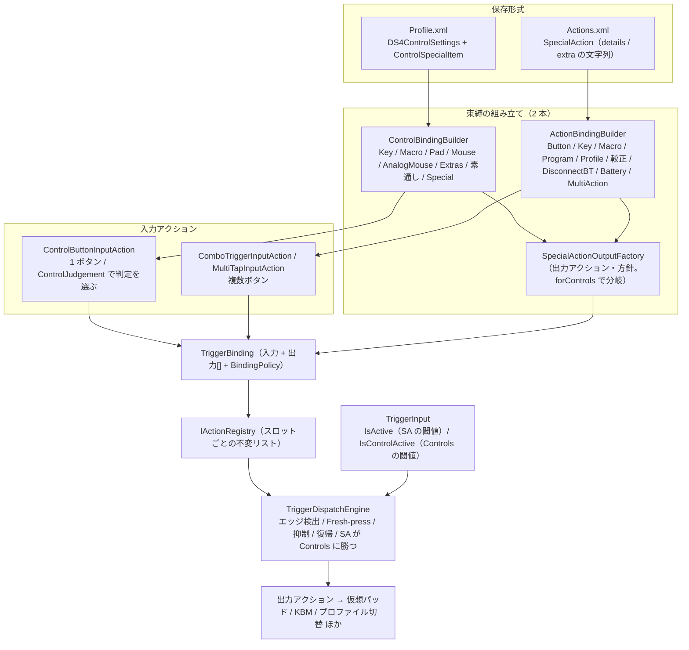
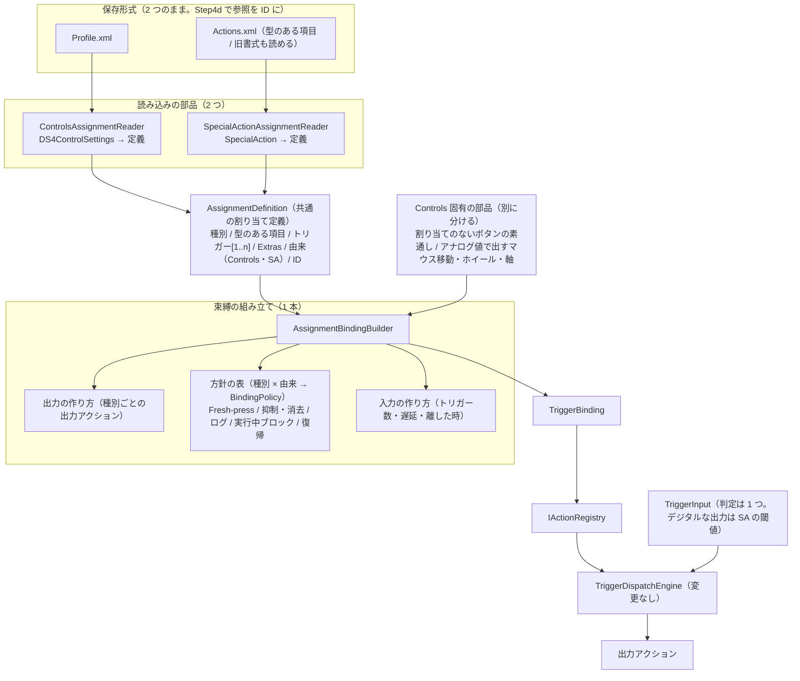

# Phase10 完成形のモデルと、統合 Step の骨子（案）

作成日: 2026-10-21
対象ブランチ: `For-DI-migration-work`
位置づけ: `Phase10-Step4c-Plan.md`（仕様変更）と、統合 Step（旧 Step6 を前倒し）の**ゴール**を 1 か所に示す文書。各 Wave・Step が、完成形のどこを埋めるのかを確認するために使う。
状態: **承認済み（2026-10-21、ユーザー）。ただし §6 の確認事項 1 は、「由来で決める」へ訂正済み（Step4c 計画書 §2 項目 3・§6 も同様）。確認事項 2・3 は統合 Step の I0 で決める**。製品コードは変えていない。`03-Class-Interface-Diagram.md` への反映は、実装した Step ごとに行う（この文書の図は、まだ実装されていない部分を含む）。

---

## 1. 目的

> 入力信号を DS4Windows が受け取った以降の処理を、**Controls タブ・SpecialActions タブのどちらで設定されたかに依存せず**、共通の経路を通して処理する形にする。

そのために必要な作業は 2 種類あり、**混ぜずに**順に行う（原因の切り分けのため）。

| 種類 | Step | 内容 |
|---|---|---|
| 挙動の差を減らす（実機の動作が変わる） | **Step4c** | 閾値、Fresh-press ガード、ログ、検証、入力の集合 |
| 構造を 1 本にする（挙動は変えない） | **統合 Step** | 共通の割り当て定義、builder の統合、暫定構造の撤去 |
| 参照の持ち方を変える | Step4d | プロファイルと SA の参照を、名前から固定 ID へ |

## 2. 現在の経路（Step4 W6 時点。実装済み）

保存形式から束縛の組み立てまでが 2 本に分かれている。**実行（エンジン）から先は、すでに共通**。

## 3. 完成形の経路（統合 Step 後。案）

保存形式は 2 つのまま（ユーザー決定: SA は共有のまま。E は見送り）。**読み込みの部品を 2 つ、共通の割り当て定義を 1 つ、builder を 1 つ**にする。

完成形の要点:

- 種別（Key、Macro、Program、Profile、…）の解釈と、出力アクション・方針の作り方は、**1 か所**。種別を足すと、Controls と SA の両方で使える。
- 「Controls か SA か」は、**定義の由来**という 1 つの項目に集約する（`forControls` の引数と、2 つの builder を廃止）。方針の表は、種別 × 由来で引く。
- エンジン（`TriggerDispatchEngine`）と、優先順位・抑制の仕様（`Phase10-Assignment-UI-Unification-Plan.md` §7 の R1〜R10）は変えない。

## 4. 差の一覧と、どの Step で消えるか

| 差 | 現行 | Step4c | 統合 Step | 完成形 |
|---|---|---|---|---|
| 押下判定の閾値 | SA は厳しい／Controls は緩い | **W4**: デジタルな出力は SA の閾値に揃える | `ControlJudgement` を、**出力の種類**（デジタル／アナログ）から決まる性質へ置き換える | 判定の差は、出力の種類だけ |
| Fresh-press ガード | 束縛ごとに個別指定 | **W1**: 1 枚の表に（挙動は変えない） | 方針の表に統合 | 種別ごとに 1 か所 |
| ログ | Controls の既存の種別は静か | **W2**: SA 形式の立ち上がりのログを出す | 方針の項目に | 全種別で同じ |
| 保存の可否の検証 | エラーを出すだけ。Controls は呼ばない | **W3**: 必須の値がないエラーは保存を止める | 検証は種別ごとの入力に 1 本 | `CanWrite` 廃止 |
| 入力の集合 | SA に Touch Started/Ended なし、Controls に LS/RS Outer なし | **W5**: 追加のみ | — | 集合が同じ |
| 元の出力の消し方 | Controls は毎フレーム消す／SA は成立中だけ抑える | 見送り（仕様 R1〜R10） | 方針の項目（`ErasesOutputEveryFrame`）として残す。**§6 の確認事項 1** | 由来で決まる 1 項目 |
| SA の Extras | Controls だけ | — | **実装**（動作は Controls と同じ。重なれば SA が勝つ） | 両方で使える |
| 文字列の受け渡し（SA） | `details`/`extra` の文字列 | — | **型のある項目へ**（Q7。旧書式の読み込みは維持） | 定義が共通 |
| プロファイル・SA の参照 | 名前 | — | — | **Step4d**: 固定 ID |
| 暫定の構造 | `forControls`、`ControlJudgement`、`BuiltSpecialTypes`、`ControlSpecialEditors` | — | **撤去** | なし |

## 5. 統合 Step の骨子（案。個別計画書は別に作る）

順序の考え方: **挙動を変えずに**、定義 → 読み込み → builder の順に置き換える。各段階で Phase8・Phase10 の特性化テスト（W0 を含む）を守りにする。

| 段階 | 内容 | 守りにするテスト |
|---|---|---|
| I0 | 最初に確認すること（§6）をユーザーに確認する | — |
| I1 | `AssignmentDefinition`（共通の割り当て定義）の型を作る。`ControlSpecialItem` を土台にする | 型の単体テスト |
| I2 | SA の型のある項目（Q7）。`SpecialAction` ⇄ `Actions.xml` を型のある項目で往復。旧書式の読み込みを維持 | 読込テスト（旧書式）、往復テスト |
| I3 | 読み込みの部品 2 つ（Controls／SA → 定義）。builder の入力を定義にする（出力は同じ束縛） | Step4c W0 の方針の表、Phase8 の特性化テスト |
| I4 | builder を 1 本に統合。`forControls` を「由来」へ置き換え。`ControlJudgement` を出力の種類へ置き換え | 同上 |
| I5 | SA の Extras を実装 | 新規テスト + 実機 |
| I6 | 暫定の構造の撤去（`BuiltSpecialTypes`、`ControlSpecialEditors`、`CanWrite` 残り）。`SpecialActionEditor` → `AssignmentEditor` の改名。旧 `BindingWindow` の Full／Keyboard の撤去 | ガードテスト |
| I7 | 文書（モデル図 `03` の更新、完了報告、台帳）。回帰の実機確認（台帳 §22） | — |

統合後に行う: W7・W8 相当（Check Battery、Multi-action を Controls へ）→ Step5（SA 側のアナログ出力）。

## 6. 統合 Step の最初に確認すること（未決定）

1. **「元の出力の消し方」の置き換え規則（決定済み: 由来で決める）**: Step4c 計画書は当初「`forControls` を『トリガーが 1 つか』の判定へ置き換える」としていた。しかし、**単体のトリガーの SA** は現行で「成立中だけ抑える」ため、トリガー数で切り替えると、単体の SA の挙動が変わる（遅延つき・Run on release・MultiAction で、成立前に元の出力が出なくなる。R1 に反する）。挙動を変えないためには、**「トリガー数」ではなく「定義の由来（Controls／SA）」で決める**必要がある。どちらにするか。
2. **Controls にも複数ボタンの組み合わせを許すか**（項目 8）。許すなら、トリガーの供給元と、保存形式（`Profile.xml`）が変わる。許さないなら、由来が Controls の定義は、トリガーが常に 1 つ。
3. **SA の Extras を付けられる種別**: すべての種別か。重なったときの細部（「SA の Extras が成立している間だけ」か「SA のトリガーのボタンはつねに」か）。

## 7. Step4c の各 Wave が埋める場所（2026-10-21 完了）

| Wave | 完成形で埋める場所 |
|---|---|
| W1 | 方針の表（Fresh-press の列） |
| W2 | 方針の表（ログの列） |
| W3 | 検証の規則（種別ごとの入力に 1 本） |
| W4 | `TriggerInput` の判定（デジタルな出力は 1 つの閾値） |
| W5 | 入力の集合（`TriggerCatalog`、`MappingListViewModel`、`ControlSettingsGroup`） |

## 8. Step4c の結果と、統合 Step への引き継ぎ（2026-10-21）

Step4c（W0〜W5）は完了した。完成形のうち、**挙動の差は次のとおり減った**。実機確認（台帳 §27）は先送り中。

| 差 | Step4c の後の状態 |
|---|---|
| Fresh-press ガード | 規則は `FreshPressGuardTable`（`ForSpecialAction`／`ForControls`）の 1 か所。統合 Step で、方針の表（種別 × 由来）の 1 列にする |
| ログ | 立ち上がり・離したときを、全種別が出す。離したときはエンジンが全種別で出す（`BindingPolicy.LogsReleaseEdge`）。立ち上がりは、出力アクションが出す種別と、エンジンが出す種別（Controls の Pad／Mouse／AnalogMouse／Extras。`LogsRisingEdge`）がある。統合 Step で、立ち上がりも 1 か所（エンジン）にまとめられる（SA の出力アクション 9 クラスに、同じ Trace の 4 行が重複している） |
| 保存の可否の検証 | 必須の値がないエラーは `IsValid` が偽を返し、保存を止める（SA・Controls 共通）。対象の入力は赤い枠で示す。`CanWrite` は削除済み。統合 Step の検証は、これを引き継ぐ |
| 押下判定の閾値 | デジタルな出力は SA の閾値（`ControlJudgement.Trigger`）、アナログな出力は従来の判定（`Assignment`）。統合 Step で、`ControlJudgement` を「出力の種類（デジタル／アナログ）から決まる性質」に置き換える |
| 入力の集合 | Controls と SA で同じ（51 項目ずつ） |

**統合 Step に引き継ぐこと**
- 項目 10（SA の Extras）の設計（§4・§6）。動作は Controls と同じ。同じボタンで重なったら SA が勝つ。付けられる種別と細部は I0 で決める。
- §6 の確認事項 2・3（Controls の複数ボタン、SA の Extras の種別・細部）。
- 暫定の構造の撤去: `forControls`、`ControlJudgement`、`ControlBindingBuilder.BuiltSpecialTypes`、`ControlSpecialEditors`。
- Multi-action の未設定のマクロ（保存を止めるか）は、Controls に Multi-action が来る段階（W8 相当）で決める。
- 解除トリガーの旧データのエラー表示「No unload triggers specified」は、機能廃止済みで入力する画面もない。表示のみ（保存は止めない）。統合 Step で、表示ごと削除するか決める。
- 先送りの実機確認（台帳 §27）は、統合 Step の後に回帰として確認する。

## 9. Step4d の結果と、統合 Step への引き継ぎ（2026-10-21）

Step4d（W0〜W7。W6 は W6'）は完了した。完成形のうち、**参照の持ち方**は次のとおり変わった。実機確認（台帳 §27）は先送り中。

| 項目 | Step4d の後の状態 |
|---|---|
| プロファイルの識別 | プロファイル XML のルート直下の先頭の `<ProfileId>`（GUID の `N` 形式）。名前（ファイル名）を変えても変わらない。起動時に全ファイルへ一括で書く |
| SA の識別 | `Actions.xml` の `Action` の `Id` 属性（`SpecialAction.id`）。編集・名前変更で引き継ぐ（`SaveAction` の `actionId`）。起動時に割り当てる |
| 保存する参照 | ID が主・名前を併記（ID が勝つ。見つからなければ名前）: `<ProfileActionIds>`、SA／Controls の Load Profile（`ProfileId`）、スロットの選択・自動プロファイル（`<ControllerProfileIds>`）、リンク（`Id` 属性） |
| 実行時の保持（プロファイル） | 保管は ID で、名前を読み書きする窓口: `ProfileSlotNames`（スロットの現在・直前・選択、一時プロファイル、リンクの表示用、自動プロファイル）、`LinkedProfileMap`（リンク）。登録簿 `IProfileIdentityService` が ID ↔ 名前を引く（メモリの索引） |
| 実行時の保持（SA） | 名前のまま（W6' の決定。`ActionManager` の登録簿は、SA の一覧の読み込み直しのたびに破棄される。合成 SA は ID を持たない） |
| 追従のコード | 実行時に不要になったものは撤去。ID のない古いプロファイルのファイルのために、`ReplaceControlProfileSwitchTarget`／`ReplaceActionReference` を残す |

**統合 Step に引き継ぐこと**
- 共通の割り当て定義（`AssignmentDefinition`）に、**固定 ID**（SA の `id`、Controls の割り当て）と、**切り替え先の ID**（`ProfileId`）を含める。Controls の定義は、プロファイル内の割り当てで、ID は持たない（SA は共有）。
- 古いプロファイルのファイルへ ID を書き足す移行（起動時の一括書き込み）を用意し、`ReplaceControlProfileSwitchTarget`／`ReplaceActionReference` を撤去する（TODO）。
- SA の実行時の状態（`profileActions`、`ActionManager` の鍵）を名前のまま残す決定（W6'）の見直しは、統合 Step で、合成 SA の鍵を整理するときに、改めて検討する。
