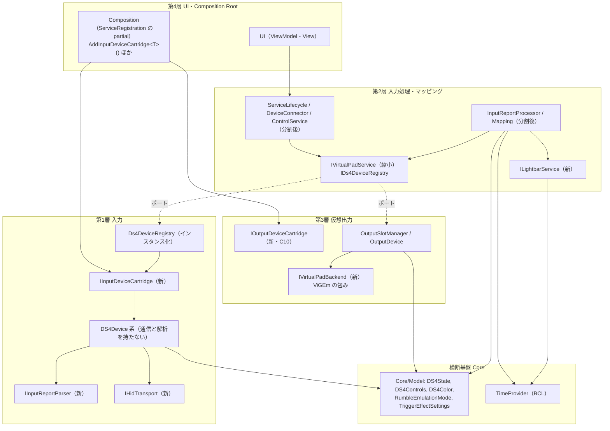

# Phase16 個別計画書: 第 1 層・第 3 層のカートリッジ化と、コンストラクターの引数の整理

作成日: 2026-11-10
状態: **草案。決定 C2・C7・C9 と範囲のオプションは確認済み（2026-11-10。§4.1）。計画書全体の承認を待つ。承認を得るまで、コードは変更しない**
ブランチ: `Phase16`（master 3f411707 から作成）
根拠: `Phase11-and-Beyond-Roadmap.md` §3 Phase16・§8.1、`FurtherImprovements/01`（3.3）・`02`（4 章）・`03`（Phase D）、`Phase9-Responsibility-Split-Plan.md` 9-H、`Repository-Review-2026-11-05.md`（R-05 後半・R-07・R-08・R-11・R-17）、`Phase13-Completion-Report.md`（`ControlService` 34 → 17 引数）、`Phase15-Completion-Report.md` §7、`Phase15-8-Plan.md`、`Known-Issues-Ledger.md`、`Model-Diagram/01〜04`
規約: `.github/copilot-instructions.md`（特に 1 章の依存の向き、2.2 機能の完全維持、2.3 ログの維持、3.3 の 5 原則、3.4 のフォルダ規則、4 章の開発プロセス）

---

## 1. 目的

Phase16 は、次の 2 つを 1 つの Phase として行う。第 1 層・第 3 層を分ける場所は、巨大なコンストラクターを持つクラスの依存が消える場所と重なるため、別の Phase にせず、分離の直後に該当クラスを整理する。

### 1.1 第 1 層・第 3 層のカートリッジ化（ロードマップの既存分）

| ID | 内容 | 出典 |
|---|---|---|
| T1 | 第 1 層の通信（`IHidTransport`）と解析（`IInputReportParser`）の分離。機種ごとの記述子（`IInputDeviceCartridge`）、`DS4Devices` のインスタンス化 | 9-H、FI の Phase D、R-07 |
| T2 | 仮想パッド出力の ViGEm 分離（`IVirtualPadBackend` など）と、`IVirtualPadService` から具象の公開をやめること。偽の実装でドライバなしにテストする | §8.1、R-08 |
| T3 | マクロの再生・繰り返し・タップ間隔の時間の扱いを `TimeProvider` 経由にする | Phase14d-Plan §10 |
| T4 | ライトバーの色の計算を第 1 層の `DS4LightBar.updateLightBar` から第 2 層の `ILightbarService` へ | R-05 後半 |
| T5 | 層間の状態の型（`DS4State` など）を `Core/Model` へ | R-17 |
| T6 | 機種ごとの設定クラスの共通化（`DeviceOptionsBase` など）。`ServiceRegistration` の partial をカートリッジの登録の受け皿にする | R-07・R-11 |
| T7 | 記録のみの規則 L2（Core → 第 1 層・第 3 層。現在 30 件）と L7（UI → 第 1 層・第 3 層。5 件）の解消 | 規則 L2・L7 |
| T8 | （出力側のカートリッジ）`OutContType` の分岐を `IOutputDeviceCartridge` の辞書引きへ | R-08（決定 C10 で扱いを確認） |

### 1.2 コンストラクターの引数の整理（今回の追加分）

引数が多いクラスは、責務が混ざっているか、同じ種類の依存が束ねられていないことが多い。次の 3 つの手段を、区別して使う。

| 手段 | 内容 | 対象 |
|---|---|---|
| A. 責務の分割 | クラスが持つ責務を分け、依存を新しいクラスへ移す | `Mapping`、`DeviceConnector`、`ServiceLifecycle`、`InputReportProcessor`、`ControlService` |
| B. 束ね役 | 同じ意味のまとまりの依存を 1 つの契約にする（Phase15-6 の `ForSlot` と同じ発想。ただし何でも箱にしない） | `ActionBindingBuilder`・`SpecialActionOutputFactory` が共通して持つアクション用ポート |
| C. 値の入れ物 | 依存の注入ではない引数（`AssignmentDefinition`、`BindingPolicy`）。別扱い | 決定 C5 |

引数の数だけを指標にしない。減らした効果は、**そのクラスを単体で作るのに必要な偽物の数**、**変更が及ぶファイル数**でも確かめる（§9）。

---

## 2. 現状調査（2026-11-10、master 3f411707）

### 2.1 コンストラクターの引数の再計測

方法: `DS4Windows/` 配下の `.cs`（`obj/`・`bin/` を除く）を、コメントと文字列を除いたうえで正規表現で数えた（`public/internal/protected/private` の型名と同名のコンストラクターと、主コンストラクターを対象。`partial` は別ファイルに分かれていても型名で見る）。ネスト型は対象に含むが、拡張メソッドの `this` 引数などは数えない。テストの `DS4WindowsTests` は含めない。**本番に入れる検査は、正規表現ではなくリフレクション（決定 C7）にする**。

| 区分 | 件数（今回） | 事前の調査 |
|---|---|---|
| コンストラクター総数 | 412 | 397 |
| 5 個以上 | 72 | 70 |
| 8 個以上 | 32 | 31 |
| 10 個以上 | 23 | 23 |
| 12 個以上 | 14 | 14 |
| 15 個以上 | 10 | 10 |
| 20 個以上 | 3 | 3 |

総数の差（412 対 397）は、同じ型の複数のコンストラクター（過負荷）と非公開のコンストラクターを数えたため。10 個以上は事前の調査と完全に一致した。

上位（引数の数。同名の複数は降順）:

| 順 | クラス | 引数 | 種別 | Phase16 での扱い |
|---|---|---|---|---|
| 1 | `Mapping` | 28 | 第 2 層の核 | 手段 A（Step 16-1 と 16-10） |
| 2 | `MainWindow` | 21 | UI（View） | 生成物側が減れば追随。単独では扱わない（C6） |
| 3 | `MainWindowFactory` | 20 | UI（工場） | 同上 |
| 4 | `ViewModelFactory` | 19 | UI（工場） | 同上 |
| 5 | `DeviceConnector` | 18 | 第 2 層 | 手段 A（Step 16-4c） |
| 5 | `EditorWindowFactory` | 18 | UI（工場） | 同上 |
| 7 | `ControlService` | 16 | 第 2 層 | 手段 A（Step 16-5a） |
| 7 | `ActionBindingBuilder` | 16 | 第 2 層 | 手段 B（Step 16-9） |
| 7 | `ServiceLifecycle` | 16 | 第 2 層 | 手段 A（Step 16-4c） |
| 10 | `InputReportProcessor` | 15 | 第 2 層 | 手段 A（Step 16-7） |
| 11 | `SpecialActionOutputFactory` | 14／13 | 第 2 層（過負荷 2 つ） | 手段 B（Step 16-9） |
| 12 | `AssignmentDefinition` | 12 | 値の入れ物 | C5 |
| 12 | `ProfileApplicationService` | 12 | 第 2 層 | 対象外（§3） |
| 14 | `BindingPolicy` | 11（bool 7 個ほか） | 値の入れ物 | C5 |
| 14 | `DeviceDisconnectHandler` | 11 | 第 2 層 | 対象外（§3） |

### 2.2 手段 A の 5 クラスの責務（実コードで確認）

#### `Mapping`（28 引数、約 1,100 行）

フィールドの本体での使用回数と、メソッドごとの使用を調べた。**未使用の依存が 3 つある**: `profileApplication`、`_processLauncher`、`_profileSwitcher` は、宣言と代入だけで、本体では読まれていない（Step 16-1 で削除し、28 → 25。実施済み）。`_stickMotion` のフィールドも未使用だったが、引数 `stickMotion` はコンストラクターで配列の参照を取り出すために使うため、引数は残る。

残る依存は、次の 4 つのまとまりに分かれる。

| まとまり | 依存 | 使うメソッド |
|---|---|---|
| 曲線・デッドゾーン段 | `IStickDeadZoneProcessor`、`IOutputCurveProcessor`、`ITriggerDeadZoneProcessor`、`IGyroControlsProcessor`、`IStickInputConditioner`（5） | `SetCurveAndDeadzone`（158 行）だけ |
| スティック／マウス変換段 | `IFlickStickProcessor`、`IButtonMouseMovementCalculator`、`IMouseMotionQuantizer`、`IGyroMouseStickBlender`（4） | `ProcessStick`、`SampleMouseMovement`、`TempMouseJoystick`、`MapCustom` |
| 切断の後始末 | `IKeyButtonControllerRegistry`、`ISyntheticDispatcher`、`IMacroPlayback`（3） | `HandleDeviceDisconnect`（62 行）が中心。`IMacroPlayback` はマクロの直接再生でも使う |
| 特殊アクション | `ITriggerDispatchEngine`（9 回使用）、`IProfileActionProvider`、`ISpecialActionRepository`、`IManagedActionManager` | `MapCustom`、`MapCustomAction`、`ProcessControlSettingAction`、`CheckForSpecialActionSuppression` |

ほかに、状態の入れ物（`SyntheticInputState`、`MacroRuntimeState`）、`IVirtualKBM`、`IProfileSettingsService`（15 回）、`IDeviceSlotState`、`ITwoStageTriggerProcessor`、`IControlActivityReader`、`ISyntheticInputCommitter` がある。

`Mapping` は `IMacroStringPlayer` も実装している（`DefaultMacroStringPlayer` と並ぶ）。この関係は、Phase13 の報告書で `Func<IMapping>` が残る理由（`DefaultActionManager` → `IMapping` の循環）に関わる。マクロ文字列の再生を `Mapping` から外せれば、この `Func` を外せる可能性がある（§6 のリスクに記す）。

**要点**: `Mapping` は毎フレームの経路（ホットパス）にある。分割は、入力 → 出力の特性化テストと、Phase13 Step5b と同じ A/B 計測（割り当て 0、有意な悪化なし）を付けて行う。

#### `DeviceConnector`（18 引数、196 行）

公開メソッドは `BeginPrepare` と `PrepareConnected`（約 100 行）。`PrepareConnected` は、次の 3 つの仕事を 1 つのメソッドで行う。

| 仕事 | 依存 |
|---|---|
| (1) 設定・プロファイルの準備 | `IProfileSettingsService`、`IProfileXmlStore`、`IConnectionProfileSelector`、`IInputDeviceModuleRegistry`、`IAppSettingsService` |
| (2) 出力の接続（仮想パッドのプラグイン、結合デバイスの出力の共有、OSC、UDP） | `IVirtualPadService`、`IOutputDeviceTypeState`、`IOscService`、`IUdpMotionService`、`IHidHideService` |
| (3) 入力側の配線（イベントの購読、スロットの `Mouse` の生成、レポートの処理への接続） | `IDeviceDisconnectHandler`、`IDs4DeviceRegistry`、`IVirtualKBM`、`StickMotionState`、`SyntheticInputState`、`IDeviceConnectionSetup`、`IDeviceSlotState`、`IInputReportProcessor` |

(2) は Step 16-4（出力側の分離）で `IVirtualPadService` の契約が小さくなったあとなら、`ConnectedDeviceOutputPlugger`（仮称）へ移せる。移すと、18 → 約 11。

#### `ServiceLifecycle`（16 引数、444 行）

`Start`（約 130 行）、`Stop`、`HotPlug`、`PrepareAbort`。`Start` は、(1) 出力サービスの開始（ViGEm、仮想キーボード・マウス、OSC、UDP、HidHide）、(2) デバイスの探索と接続（`DeviceRegistry`、`DeviceConnector`、`JoyConLinker`）、(3) 周辺の設定（プロセス優先度、ホットプラグ）の順に進む。(1) に使う依存は 5〜6 個（`IVirtualPadService`、`IOutputKbmInitializer`、`IVirtualKBM`、`IOscService`、`IUdpMotionService`、`IHidHideService`）。Stop も同じ出力サービスを使う。出力サービスの開始・停止を `IOutputServicesLifecycle`（仮称）に移すと、16 → 約 10。

#### `InputReportProcessor`（15 引数、306 行）

`OnReport` 1 つに、レイテンシ計測、電池のトレイ表示、プロファイルの読み込みログ（`IPathService`、`IProfileRepository`）、結合デバイスの出力、タッチパッドの切り替え、マッピング、OSC の前後処理、仮想コントローラーへの送信と振動、同期イベントの出力、ライトバー更新が入っている。Step 16-6（ライトバー）の後に、「レポートの副作用の通知」（電池のトレイ表示、読み込みログ）と「仮想コントローラーへの送信段」（`IVirtualPadService`、`IOutputDeviceTypeState`、OSC）を外す。15 → 約 10。

#### `ControlService`（16 引数、約 440 行）

Phase13 で 34 → 17 にした。残る役目は、デバイスの初期化フック（`PrepareDS4DeviceInit`、`PostDS4DeviceInit`、`CheckForSupportedDevice`、`RequestElevation`、`WarnExclusiveModeFailure`）、適用したプロファイルの記憶（`RememberAppliedProfile`）、二段トリガー設定の変更でのリセットの購読、ViGEm 失敗の通知。デバイスの登録簿が静的な `DS4Devices` を静的なデリゲートで呼び返す形（`_deviceRegistry.PrepareDS4Init = …`）が、これらを `ControlService` に留めている。`DS4Devices` のインスタンス化（Step 16-5a）の後に、フックを `IDeviceInitHooks`（仮称）、記憶を専用のサービスに移す。16 → 約 11。

### 2.3 第 1 層・第 3 層の現状

| 項目 | 現状（実測） |
|---|---|
| 第 1 層の大きいファイル | `DS4Device.cs` 2,062 行、`JoyConDevice.cs` 1,936、`DualSenseDevice.cs` 1,536、`SwitchProDevice.cs` 1,401、`DS3Device.cs` 646、`DS4Devices.cs` 540、`DS4LightBar.cs` 399 |
| 通信と解析 | `DS4Device` が `HidDevice`（`hDevice`）を直接持ち、`ReadFile`／`WriteOutputReportViaInterrupt`／`CancelIO` と、バイト列の解析（`performDs4Input`）が同じクラスにある。`Input/Abstractions` にあるのは `IDeviceLayerSettings` だけ |
| 機種の識別・生成 | `DS4Devices.knownDevices`（VID/PID の静的表、約 40 行）、`InputDeviceFactory`（`switch`）、`IInputDeviceModule`（第 2 層の接続時フック）の 3 か所に分かれる |
| `DS4Devices` | 静的クラス。辞書 4 つ、`Stopwatch`、静的イベント、静的デリゲート 3 つ（`PrepareDS4Init`、`PostDS4Init`、`PreparePendingDevice`）、`isExclusiveMode`、`LayerSettings`。包みの `Ds4DeviceRegistryAdapter` 経由で使われている |
| ViGEm の参照 | `Nefarius.ViGEm` を参照するのは 8 ファイル: 第 3 層の 7（`DS4OutDevice`、`DS4OutDeviceBasic`、`DS4OutDeviceExt`、`DS4OutDeviceFactory`、`Xbox360OutDevice`、`OutputSlotManager`、`VirtualPadService`）と、第 2 層の `ControlService`（`OutputSlotManager.ViGEmFailure` の購読） |
| `IVirtualPadService` | `OutputSlotManager`、`OutputDevice[]`、`OutSlotDevice`、`DS4Device` を公開する。ポートになっていない |
| `OutContType` の分岐 | 17 ファイル |
| 層間の状態の型 | `DS4State` を使うファイル 49、`DS4Controls` 79、`DS4Color` 31、`SixAxis` 20。第 3 層の 13 ファイルが第 1 層の型に依存 |
| ライトバーの色の計算 | `DS4LightBar.updateLightBar`（第 1 層）が、虹色、電池連動、点滅、充電中、無操作でのフェードを計算し、`DateTime.UtcNow` と `Stopwatch` を使う。呼び出しは `InputReportProcessor` と `ServiceLifecycle` の 2 か所 |
| 時間の扱い | `TimeProvider` の使用は 0 件。実時間の待ちは `MacroPlayback`（`Task.Delay(...).Wait()` ×2）、`RepeatHelper`（`Timer`）、`KeyButtonActionController`（初回リピートの遅延）、`Mouse`（タップ後の保持）。マクロ関連のテストは 10 ファイル以上が `MacroPlayback`／`RepeatHelper`／`MacroStepExecutor` を扱う（一覧は 16-2 の計画書で確定） |
| 対象フレームワーク | `net8.0-windows10.0.19041.0`（`System.TimeProvider` と `TimeProvider.CreateTimer` が標準で使える） |

#### 記録のみの規則 L2（Core → 第 1 層・第 3 層）の 30 件の内訳

`LayerDependencyRuleTests.RecordOnlyLayerDependencies_MatchTheCountRatchet` の実測を種別に分けた。

| 種別 | 件数 | 内容 | 解消する Step |
|---|---|---|---|
| (a) `DualSenseDevice` の入れ子の型（`RumbleEmulationMode`）と `TriggerEffectSettings` | 8 | 設定値の型が第 1 層のクラスの中にある | 16-1（`Core/Model` へ） |
| (b) `DS4Device` を引数・戻り値に持つ契約と永続化 | 8 | `IDeviceStateAccessor`、`IProfileLoadTarget`、`IProfileXmlStore`、`ControllerConfigsXmlSerializer`、`LegacyProfileXmlSerializer`、`ProfileXmlStore`、`BackingStore`、`ProfileSettingsService` | 16-5c（機器の狭い契約を `Core/Abstractions` に置く） |
| (c) 出力の型（`OutputSlotManager`、`OutputDevice`、`OutSlotDevice`、`OutputSlotPersist`） | 8 | 出力スロットの保存と、プロファイルの読み込みの対象 | 16-4b |
| (d) `Input.Hid`／`DevicePathProbe` | 3 | `EnvironmentService` が HID の列挙・パスの確認を直接呼ぶ | 16-6a（通信の抽象の後ろへ） |
| (e) `VirtualKBMMapping`／`VirtualKBMFactory` | 3 | `IProfileSettingsService`、`ProfileSettingsService`、`ArgumentParser` | 16-4b |

L7（UI → 第 1 層・第 3 層）の 5 件: `ControllerReadingsControl`（`DS4State`、`DS4StateExposed`、`SixAxis`）、`StickCalibrationWindow`（`DS4State`）は Step 16-3（R-17）、`OutputSettingsViewModel`（`DualSenseDevice`）は Step 16-1 で解消する。

### 2.4 既存の Phase16 の項目と引数の整理の重なり

| Phase16 の項目 | 触るクラス | 引数の整理との重なり |
|---|---|---|
| 通信・解析の分離、`DS4Devices` のインスタンス化 | `DS4Device` 系、`DS4Devices`、`Ds4DeviceRegistryAdapter` | `ControlService`（静的デリゲートの呼び返し）、`DeviceConnector`（登録簿・モジュール） |
| ViGEm 分離、`IVirtualPadService` の縮小 | `VirtualPadService`、`OutputSlotManager`、`IVirtualPadService` | `DeviceConnector`（出力の接続）、`ServiceLifecycle`（出力サービスの開始・停止）、`InputReportProcessor`（`OutputDevices[…]`）、`ControlService`（`ViGEmFailure`） |
| `ILightbarService` | `DS4LightBar`、`InputReportProcessor`、`ServiceLifecycle` | `InputReportProcessor`・`ServiceLifecycle` の `LightbarOverrides` 引数 |
| `TimeProvider` | `MacroPlayback`、`RepeatHelper`、`KeyButtonActionController`、`Mouse` | **引数が 1 つ増える**（`RepeatHelper` は 9 → 10 など）。同じ Step で相殺しない場合は、理由を記録する |
| `DS4State` の移動（R-17） | 49 ファイル | なし（名前空間の書き換えのみ） |
| カートリッジの記述子・設定の共通化 | `InputDeviceFactory`、`ServiceRegistration`、`*DeviceOptions` | `ControlService`（`ControlServiceDeviceOptions`） |
| 手段 B（アクション用ポートの束ね） | `ActionBindingBuilder`、`SpecialActionOutputFactory` | Phase16 の既存の項目とは独立。第 2 層の内部の整理 |
| 手段 A の `Mapping` | `Mapping` | 既存の項目とは独立（ホットパスのため最後） |

### 2.5 Phase16 の目標の依存の図

矢印は「依存する」。第 1 層・第 3 層から第 2 層への矢印はない（規約 1 章）。第 2 層から第 1 層・第 3 層へはポート経由。

---

## 3. 範囲外にするもの（理由つき）

| 項目 | 理由 |
|---|---|
| `MainWindow` の ViewModel への分割（Phase13 の持ち越し） | 生成物側（`MainWindow` が作る ViewModel）が減れば追随して減る。UI の変更は実機で画面を見る確認が多く、第 1 層・第 3 層の実機確認と混ぜると不具合の原因を特定しにくい。決定 C6 で確認 |
| 工場（`MainWindowFactory` 20、`ViewModelFactory` 19、`EditorWindowFactory` 18）の単独の整理 | 生成物が減れば追随する。工場は生成する型の数だけ引数が増える性質で、束ねても依存の数が見えなくなるだけ |
| `ProfileApplicationService`（12）、`DeviceDisconnectHandler`（11）、`AutoProfileService`（10） | 責務は単一で、今回触る分離と重ならない。**ただし** C7 の努力目標（15 以下）の範囲内 |
| 外部アセンブリの動的な読み込み（真のプラグイン） | Phase16 のカートリッジは、同じアセンブリ内の DI 登録まで。署名・安全性・配布の設計が要るため別の Phase。`FurtherImprovements/05`（プラグイン開発ガイド）は Phase16 の完了後に実装に合わせて整備する |
| 新機種（例: Flydigi Vader 4 Pro）の追加 | カートリッジの記述子は、その追加を軽くするための土台。機種そのものの追加は、土台が固まったあとの別の作業 |
| 入力パイプラインの高速化（`FurtherImprovements/04`） | 実測で問題が出たときのみ。Phase16 は挙動と性能を変えない |
| `IProfileSettingsService` の配列プロパティの削除 | Phase15 で、他の層が使う配列が大半と判断し温存した |
| 未解決の不具合（KI-1〜KI-5）の修正 | 挙動を変えないため。KI-2（切断時にマクロの Alt が残る仮説）は、`Mapping.HandleDeviceDisconnect` を分けるときに手がかりとして記録するが、直さない |
| 利用者に見える機能・設定の保存形式・ログの文言とレベルの変更 | 規約 2.2・2.3。新規のコードのログは `Log-Policy.md` に沿って書く |

---

## 4. 決定事項（C1〜C10）

各案の長所・短所と推奨を示す。**太字が推奨**。**C2・C7・C9 と、範囲のオプション（C5・C6・C8 の Joy-Con・C10）は、AskUserQuestion でまとめて確認する（結果は §4.1）。C1・C3・C4・C8 の順序は推奨を仮採用とし、承認の際に変更できる。**

### C1. 引数の整理の位置と、Step の順序

| 案 | 長所 | 短所 |
|---|---|---|
| **A. 分離の直後に、該当クラスを整理する（交互）** | 依存が消えた直後に数えるため、二度手間がない。1 Step の変更が 1 つの領域に収まる | 引数の整理が Phase 全体に散る |
| B. 分離をすべて終えたあとに、引数の整理をまとめる | 計画が単純 | 同じクラスを 2 回触る（ControlService、DeviceConnector など） |
| C. 引数の整理を先に行う | 先に数が減る | 分離で依存が変わるたびに、また触る |

### C2. `Mapping` の分割の深さ（Step 16-10）

| 案 | 長所 | 短所 |
|---|---|---|
| **A. 3 つの段（曲線・デッドゾーン段、スティック／マウス変換段、切断の後始末）に分ける。28 → 25（16-1）→ 約 16** | 使うメソッドが明確に分かれる。毎フレームの経路を壊しにくい | 新クラス 3 つの A/B 計測が要る |
| B. 未使用の 3 引数の削除だけ（28 → 25） | ほぼリスクなし。16-1 で済む | 25 のまま。努力目標（C7）の 15 を超える |
| C. 5 つの段に分ける（上に加えて、二段トリガーと特殊アクションの段）。28 → 約 12 | 最も小さくなる | ホットパスの変更が大きく、実機確認も多い |

### C3. 手段 A の対象の 5 クラスをすべて Phase16 に入れる

| 案 | 長所 | 短所 |
|---|---|---|
| **A. 5 クラスすべて（`DeviceConnector` と `ServiceLifecycle` は 16-4c、`ControlService` は 16-5a、`InputReportProcessor` は 16-7、`Mapping` は 16-10）** | 分離で触る場所と重なるため、追加の作業が少ない | Phase が長い |
| B. `Mapping` を除く（16-1 の未使用削除のみ） | ホットパスの分割を避ける | C2 と重なる。`Mapping` が 24 のまま |

### C4. 手段 B: アクション用ポートの束ね方（Step 16-9）

`ActionBindingBuilder` と `SpecialActionOutputFactory` は、7 つのポート（`IMacroPlayer`、`IProcessLauncher`、`IProfileSwitcher`、`IGyroCalibrationPort`、`IControllerDisconnectPort`、`IBatteryCheckPort`、`IMacroStringPlayer`）を共有し、`SpecialActionOutputFactory` だけがさらに `IWindowFocuser` を持つ（実装はそれぞれ `Default…` と `WindowFocuser` で、`IMacroStringPlayer` は `Mapping` も実装する）。`ActionBindingBuilder` は、受けたポートをそのまま `new SpecialActionOutputFactory(...)` へ渡すだけの中継を含む。

| 案 | 長所 | 短所 |
|---|---|---|
| **A. 意味のある 3 つに束ねる: ①コントローラー本体への操作（`IGyroCalibrationPort`・`IControllerDisconnectPort`・`IBatteryCheckPort`）、②マクロの再生（`IMacroPlayer`・`IMacroStringPlayer`）、③外部の起動・前面化・プロファイル切替（`IProcessLauncher`・`IWindowFocuser`・`IProfileSwitcher`）** | 束ねる単位に意味がある。`ActionBindingBuilder` 16 → 約 12、`SpecialActionOutputFactory` 14 → 約 9 | 契約が 3 つ増え、`Default…` が束ねを通すだけの薄い層になる |
| B. 1 つの `IActionPorts` に全部を入れる | 引数が最も減る | 「何でも箱」。使わないポートも渡される。依存が見えなくなるだけ |
| C. 束ねず、`= null` の任意引数と過負荷（`ActionBindingBuilder` → `new SpecialActionOutputFactory(...)`）の整理だけ行う | 変更が小さい | 引数の数は減らない |

注: 現在は `= null` の任意引数が、`ActionBindingBuilder` に 10 個、`SpecialActionOutputFactory` に 7 個ある。テストで作る箇所は、`ActionBindingBuilder` が 19 か所（10 ファイル）、`SpecialActionOutputFactory` が 18 か所（10 ファイル）で、**この 2 クラスだけが、変更の及ぶ範囲が広い**（ほかの 4 クラスは、テストで手で作る箇所が 0〜2 か所で、共有ホスト経由）。

### C5. 値の入れ物（`BindingPolicy`、`AssignmentDefinition`）

| 案 | 長所 | 短所 |
|---|---|---|
| **A. 現状維持。3 つ以上の bool を持つ型は名前付き引数を必須とする規約（C7 の文言）を足す** | `BindingPolicy` の本番の生成 9 か所は、引数なし 1 件を除く 8 件がすでに名前付き。取り違えは起きにくい。変更なし | 11 個の bool のまま |
| B. 意味のある小さな型に分ける（例: `PressGuard`［`RespectsFreshPressGuard`・`BlocksWhileExecuting`］、`TriggerEffect`［`SuppressesTriggerButtons`・`ResetsTriggerOutput`・`StopOnRelease`］、`EdgeLogging`［`LogsRisingEdge`・`LogsReleaseEdge`］） | 取り違えが型で防げる | 本番 9 か所＋テスト 14 か所（4 ファイル）の書き換え。効果が小さい |
| C. 後回し | — | — |

### C6. `MainWindow` の ViewModel への分割

| 案 | 長所 | 短所 |
|---|---|---|
| **A. Phase16 に入れない。候補として台帳に残す** | 第 1 層・第 3 層の実機確認と、画面の確認が混ざらない | `MainWindow` は 21 のまま |
| B. Phase16 の末尾に入れる | まとめて終わる | UI の画面の確認が加わり、Phase が長くなる |

### C7. コンストラクターの引数の努力目標を規約に入れるか

| 案 | 長所 | 短所 |
|---|---|---|
| **A. 規約 §3.1 に追記: 新規・変更するクラスは 15 以下を努力目標とし、超えるときは理由をコメントに書く。値の入れ物・工場・View（Window）は対象外。リフレクションの検査 `ConstructorArityRuleTests` と許可リスト `ConstructorArityBaseline` で、16 以上の型を凍結し、減ったら基準値も減らす（ラチェット）** | 以後、引数が増える方向に歯止めがかかる。測り方がテストで固定される | 規約の改定と、許可リストの運用が増える |
| B. 規約には入れず、Phase16 の完了条件の指標だけにする | 規約が増えない | 以後は歯止めがない |
| C. 規約に参考値として書くだけ（検査なし） | 軽い | 守られない |

### C8. 第 1 層の分離の機種の順序とゲート（Step 16-6）

| 案 | 長所 | 短所 |
|---|---|---|
| **A. 順序は DS4 → DualSense → Switch Pro → DS3 → Joy-Con（最難）。1 機種 1 Step で、DS4 の完了時にゲート（続行／中断）を置く** | 最も使われる DS4 で通信・解析の分離を確立してから広げられる。機種ごとに戻せる | Step が多い |
| B. 全機種を一度に | 回数が少ない | 不具合の原因の機種が特定できない |
| C. DS4 と DualSense だけ行い、Switch 系・DS3 は次の Phase | リスクが小さい | 分離が中途半端（`DS4Device` の基底に旧い経路が残る） |

### C9. 実機確認の方式（**確認済み: C**＝最後に 1 回のみ。実機は DS4 のみ。§4.1**）

第 1 層・第 3 層は実機に直結する。Phase15 では「最後に 1 回」（P9）にした結果、原因の Step を特定しにくくなった（`Phase15-Completion-Report.md` §3、§8）。

| 案 | 長所 | 短所 |
|---|---|---|
| **A. 機種ごとの Step の完了時に、所有する実機で確認する。所有しない機種は、差分テスト（分離前後のバイト列 → `DS4State`）で代替し、実機確認は台帳に「見送り」と記録する** | 不具合の原因の Step が分かる | 実機確認の回数が増える |
| B. 第 1 層は最初の機種（DS4）だけ Step ごと、残りは区切りの終わりにまとめる | 回数が中間 | 後半の機種で原因の特定が難しい |
| C. 最後に 1 回 | 回数が最小 | Phase15 と同じ問題 |

### C10. 出力のカートリッジ（`OutContType` の分岐の置き換え）の扱い（Step 16-8）

| 案 | 長所 | 短所 |
|---|---|---|
| **A. 含める。ただし最後の区切りに置き、時間・リスクで打ち切れるゲートとする** | ロードマップの R-08 を満たす。出力の種類の追加が軽くなる | 17 ファイルの分岐を触る |
| B. `IVirtualPadBackend` による ViGEm 分離（16-4a・4b）まで。カートリッジ化は次の Phase | Phase16 が短くなる | R-08 の一部が残る |

### 4.1 決定結果（2026-11-10。AskUserQuestion で確認）

| ID | 結果 | 備考 |
|---|---|---|
| C2 | **A**（3 つの段。28 → 約 15） | 推奨どおり |
| C7 | **A**（規約に努力目標 15 以下を追記。`ConstructorArityRuleTests`＋`ConstructorArityBaseline`） | 推奨どおり。Step 16-0 で追加 |
| C9 | **C**（実機確認は最後に 1 回のみ）。**所有する実機は DS4 のみ** | 推奨（A）と異なる、ユーザーの判断。影響は §6・§7.2 に反映した |
| C10 | **含める**（Step 16-8） | 最後の区切りに置き、ゲートで打ち切り可 |
| C8（Joy-Con） | **含める**（Step 16-6f）。順序は DS4 → DualSense → Switch Pro → DS3 → Joy-Con、DS4 の後にゲート | 実機がないため、差分テストが唯一の検証になる（§7.2） |
| C6（`MainWindow` の分割） | **含めない**（推奨どおり）。候補として台帳に残す | |
| C5（`BindingPolicy` の bool の型分け） | **含めない**（推奨どおり）。名前付き引数の必須化を C7 の文言に入れる | |
| C1・C3・C4 | 推奨を仮採用（交互に整理／5 クラスすべて／意味のある 3 つに束ねる） | 承認の際に変更できる |

C9 の判断により、次を計画に入れた。
1. 実機は DS4 のみのため、DualSense・Switch Pro・DS3・Joy-Con は**差分テスト**で検証する（§5 の Step 16-6）。分離前のコードに偽の `IHidTransport` 越しでバイト列を流して `DS4State` を記録し、分離後と一致させる。
2. 実機確認が最後の 1 回のため、不具合が出たら Step 単位で戻せるよう、1 Step ＝ 1 つ以上のコミットを守り、`git bisect` で原因の Step を特定する。
3. 実機を所有しない機種は、リリース時の既知の制限として記載し、台帳に見送りを記録する。

---

## 5. Step 構成（案）

区切りは 3 つ。各区切りの終わりに Debug ALL（Build Debug → Build Test → Execute Test）を警告 0・エラー 0・全合格で確認し、ユーザーの指示があれば master へ取り込む（push はしない）。

**実機確認の列の読み方（C9＝C）**: 実機確認は Phase の最後（Step 16-11）に **1 回だけ**、DS4 で行う。表の「要」は「16-11 の総まとめ（§6）に含める項目」の意味で、Step の完了時には実施しない。そのかわり、各 Step は単体テスト・差分テスト・A/B 計測で自己完結させ、不具合が最後に見つかったときは `git bisect` で原因の Step を特定する。1 Step ＝ 1 つ以上のコミットで、移動（`git mv`）と名前空間の書き換えは別コミット（規約 3.4 R7）。

**共通の方針**: 各 Step の前に、その Step の細部の計画書（例: `Phase16-Step4-Plan.md`）を作り、承認を得る（規約 4 章）。新しいクラスは 1 ファイル 1 型。新規のログは `Log-Policy.md` に沿う。`Func<T>` を増やさない（`Phase13FuncRatchetGuardTests` は 2 件のまま）。静的な窓口を新設しない（規約 2.1）。

### 区切り A: 土台、時間、状態の型、出力（第 3 層）

| Step | 目的 | 主な変更ファイル | テスト | 実機確認 |
|---|---|---|---|---|
| **16-0** 物差し | 基準値の記録（引数の数、L2・L7、テストの組み立ての数、Debug ALL の時間）。リフレクションの検査の追加（C7 により） | `DS4WindowsTests/ConstructorArityRuleTests.cs`、`ConstructorArityBaseline.cs`（新）、`copilot-instructions.md`（C7＝A のとき） | 新規テスト。第 1 層のバイト列 → `DS4State` の差分テストの方式の確認（既存のテストの有無、`HidDevice` を偽物にできるか。16-6a の前提） | 不要 |
| **16-1** 無害な是正 | `Mapping` の未使用 3 引数の削除（28 → 25）。`DualSenseDevice.RumbleEmulationMode` と `TriggerEffectSettings` を `Core/Model` へ（L2 −8、L7 −1） | `Mapping.cs`、`ServiceRegistration.Processing.cs`、`Input/Devices/DualSenseDevice.cs`、`Core/Model/`、利用 19 か所ほか | 既存のテスト。保存・読み込みの黄金ファイルで、列挙型の名前が XML に出ないことを確認 | 不要（挙動不変） |
| **16-2** 時間の抽象化（T3） | マクロの再生・繰り返し・タップ間隔を `TimeProvider` 経由にする。`MacroPlayback`、`RepeatHelper`、`KeyButtonActionController`、`Mouse` | 同 4 クラス、`ServiceRegistration.Core.cs`（`TimeProvider.System` の登録）、テスト側に `ManualTimeProvider`（`TimeProvider` の自作の派生。新規パッケージは使わない） | 実時間で待つテストを仮想時間に置き換える（マクロ関連 10 ファイルが対象）。待ち時間の短縮を計測 | **要**: マクロ（再生、繰り返し、待ち時間の指定）、キーの長押しリピート、タッチパッドのタップ |
| **16-3** 状態の型の移動（T5・R-17） | `DS4State`、`DS4StateExposed`、`SixAxis` と、それが依存する型を `Core/Model` へ（L7 −4）。第 3 層の第 1 層への依存を断つ | `git mv`（1 コミット）＋名前空間の書き換え（別コミット）。49 ファイル | `Phase14NamespaceFolderGuardTests`、`LayerDependencyRuleTests`。ホットパスの A/B 計測（型の定義は変えないため差が出ないことの確認） | 不要（挙動不変）。区切り A の終わりに確認 |
| **16-4a** 出力の ViGEm 分離（T2） | ViGEm を包む `IVirtualPadBackend`（と、パッドの対象の抽象）を `Output/` に作り、第 3 層の 7 ファイルをその後ろへ。偽の実装でドライバなしにテスト。`ControlService` から `using Nefarius.ViGEm.Client` を外す（失敗の通知は `BackendFailure` イベント） | `Output/Backend/`（新）、`OutputSlotManager.cs`、`Output/Devices/*`、`VirtualPadService.cs`、`ControlService.cs` | 偽のバックエンドで、スロットの割り当て、プラグイン、アンプラグ、破棄順序のテスト。新しい規則 L9（ViGEm の型を参照してよいのは `Output` のバックエンド実装だけ） | **要**: 仮想 Xbox 360／仮想 DS4 の認識、振動の返り、ライトバーの返り、HidHide |
| **16-4b** `IVirtualPadService` の縮小 | `OutputSlotManager`・`OutputDevices`・`OutSlotDevice` の公開をやめ、必要な操作（一覧の読み取り、差し込み・抜き取り）をメソッドで出す。引数の `DS4Device` はスロット番号と振動の受け口にする。(c) 8 件と (e) 3 件の L2 を解消 | `IVirtualPadService.cs`、`VirtualPadService.cs`、`OutputSlotStore`、`OutputSlotPersist*`、`VirtualKBMMapping` ほか | 契約のテスト。`LayerDependencyRuleTests` の L2 の基準値を更新 | **要**（4a と合わせて 1 回でもよい） |
| **16-4c** `ServiceLifecycle`・`DeviceConnector` の整理（手段 A） | 出力サービスの開始・停止を `IOutputServicesLifecycle`（仮称）へ（16 → 約 10）。出力の接続を `ConnectedDeviceOutputPlugger`（仮称）へ（18 → 約 11） | `ServiceLifecycle.cs`、`DeviceConnector.cs`、新クラス 2 つ、`ServiceRegistration.Processing.cs` | 開始・停止の順序の検査（`Phase9F1StartupOrderGuardTests` 相当）、`ServiceLifecycle` のテスト 2 件の更新 | **要**: サービスの開始・停止、接続・切断・再接続、結合デバイスの出力（Joy-Con）、PC のスリープ復帰 |

区切り A の終了条件: L2 の (a)(c)(e) が解消（30 → 11）。L7 が 0。`Nefarius.ViGEm` を参照するのが `Output` のバックエンド実装だけ。

### 区切り B: 入力（第 1 層）

| Step | 目的 | 主な変更ファイル | テスト | 実機確認 |
|---|---|---|---|---|
| **16-5a** `DS4Devices` のインスタンス化と `ControlService` の整理 | 静的な `DS4Devices` を `Ds4DeviceRegistry`（インスタンス）に。静的デリゲートを、イベントまたは第 1 層のポートに。`ControlService` のフック（初期化、対応機器の確認、昇格の要求）を `IDeviceInitHooks`（仮称）へ、適用プロファイルの記憶を専用サービスへ（16 → 約 11） | `Input/DS4Devices.cs`、`Ds4DeviceRegistryAdapter.cs`、`ControlService.cs`、`App.xaml.cs`、`DualSenseDevice.cs`、`TrayIconViewModel.cs`、`IElevatedProcessLauncher.cs` | 登録簿のテスト（偽の HID 一覧）。静的状態がテストへ漏れないこと | **要**: 起動前後の接続、排他モード（HidHide あり／なし）、昇格の要求、再接続でのプロファイル復元 |
| **16-5b** 入力のカートリッジの記述子と、機種の設定の共通化（T1・T6、R-07・R-11） | `IInputDeviceCartridge`（機種、VID/PID の一覧、生成）。`knownDevices` と `InputDeviceFactory` の `switch` をカートリッジの組み立てへ。`DeviceOptionsBase`、`DeviceSupportSettings` の基底。`ServiceRegistration` に `AddInputDeviceCartridge<T>()`。保存形式（XML）は変えない | `Input/Abstractions/IInputDeviceCartridge.cs`、`Input/Devices/*Cartridge.cs`（新）、`Core/Settings/*DeviceOptions.cs`、`Core/Persistence/Dto/*SupportSettings.cs`、`ServiceRegistration.*.cs` | 設定の保存 → 読み込みの黄金ファイル（`Profiles.xml`／`Auto…`）。VID/PID 表の全件が同じ機種・機能フラグに解決されること | **要**: 全所有機種の認識、機種ごとの設定の保存・反映 |
| **16-5c** 機器の狭い契約（L2 (b) の解消） | `DS4Device` を引数・戻り値に持つ契約（`IDeviceStateAccessor`、`IProfileLoadTarget`、`IProfileXmlStore` など）を、`Core/Abstractions` の狭い契約（例: `IConfigurableDevice`。MAC、名前、種類、設定の保存先）に替える。`DS4Device` が実装する | `Core/Abstractions`、`Core/Persistence`、`Core/Settings`、`DS4Device.cs` | `LayerDependencyRuleTests`（L2 −8） | 不要（5b と合わせて確認） |
| **16-6a** `IHidTransport` の導入（T1） | `DS4Device` 系の `hDevice` の利用（読み取り、書き込み、`CancelIO`、特徴レポート）を `IHidTransport` 越しにする。`HidDevice` の実装を包む。(d) の L2（`EnvironmentService` → HID）を解消。動作は変えない | `Input/Abstractions/IHidTransport.cs`、`Input/Hid/HidTransport.cs`（新）、`DS4Device.cs` ほか第 1 層、`EnvironmentService.cs` | 偽の transport で、読み取りの成功・タイムアウト・切断、書き込みの失敗の経路をテスト。**分離前のコードに偽の transport 越しでバイト列を流して `DS4State` を記録する差分テストの土台を作る**（以後の 16-6b〜f が比較する基準）。規則 L10（`HidDevice` の具象を参照してよいのは transport の実装だけ） | **要**: 全所有機種の入力・出力（ボタン、スティック、タッチ、ジャイロ、振動、ライトバー）、USB／Bluetooth、切断 |
| **16-6b** DS4 の `IInputReportParser` | 受信バイト列の解析（USB／Bluetooth の 2 形式）を、OS に依存しないパーサーへ分離。`UniversalControllerState` ではなく、既存の `DS4State` に書く（型を増やさない） | `Input/Abstractions/IInputReportParser.cs`、`Input/Parsers/Ds4ReportParser.cs`（新）、`DS4Device.cs` | 差分テスト: 16-6a で記録した分離前の出力（DS4 は実機のダンプ、固定シードの乱数、各フィールドの境界値）と、分離後の `DS4State` が一致すること。ホットパスの A/B 計測（割り当て 0、有意な悪化なし） | **要**: DS4（USB・Bluetooth）。**ゲート**: ここで続行／中断を判断（C8） |
| **16-6c** DualSense | トリガー効果、ハプティクス、ライトバー、2 形式の解析 | `Input/Parsers/DualSenseReportParser.cs` ほか | 同上（バイト列は、既存のコードのオフセットと境界値から作る。実機のダンプはない） | 実機なし（見送り。差分テストで代替） |
| **16-6d** Switch Pro | 解析、キャリブレーション、振動 | `Input/Parsers/SwitchProReportParser.cs` ほか | 同上。初期化やキャリブレーションの書き込み・応答は、偽の transport に台本（応答の列）を持たせる | 実機なし（見送り） |
| **16-6e** DS3 | 解析 | `Input/Parsers/Ds3ReportParser.cs` ほか | 同上 | 実機なし（見送り） |
| **16-6f** Joy-Con | L／R／Grip、結合デバイス、1,936 行。最難 | `Input/Parsers/JoyConReportParser.cs` ほか | 同上。結合デバイスの状態の受け渡しも差分で比較。**差分テストで覆えない部分が見つかった場合は、Step の計画書でユーザーに報告し、続行／中断を確認する** | 実機なし（見送り） |
| **16-7** ライトバーの色の計算の移動（T4）と `InputReportProcessor` の整理 | `updateLightBar` の色の計算を第 2 層の `ILightbarService` へ。第 1 層は「色を受けてレポートに書く」だけにする。時間は `TimeProvider`。`InputReportProcessor` から、レポートの副作用の通知（電池のトレイ表示、読み込みログ）と、仮想コントローラーへの送信段を外す（15 → 約 10） | `DS4LightBar.cs`、`ILightbarService`・`LightbarService`（新）、`InputReportProcessor.cs`、`ServiceLifecycle.cs`、`LightbarOverrides` の利用箇所（15 ファイル） | 色の計算の特性化テスト（虹色、電池連動、点滅、充電中、無操作のフェード）。仮想時間で検証 | **要**: ライトバーの全モード（DS4 または DualSense）、電池連動、点滅、プロファイル切替での色、キャリブレーション中 |

区切り B の終了条件: L2 が 0（目標）。`DS4Device` 系が `HidDevice` の具象を直接持たない。機種の追加が「デバイス＋パーサー＋カートリッジ 1 つ＋登録 1 行」。

### 区切り C: 出力のカートリッジ、束ね役、`Mapping`、完了

| Step | 目的 | 主な変更ファイル | テスト | 実機確認 |
|---|---|---|---|---|
| **16-8** 出力のカートリッジ（T8、R-08。C10） | `OutContType` の分岐（17 ファイル）を `IOutputDeviceCartridge`（生成、振動・ライトバーの戻りの接続、表示名、保存のキー）の辞書引きへ | `VirtualPadService`、`ProfileSettingsViewModel`、`SlotDeviceEntry`、`ProfileOutputControllerLoadSection`、`ProfilePresets`、`MacroParser`、`OutputSlotManager`、`IpcCommandProcessor` ほか | 出力の種類ごとの契約テスト | **要**: 出力の種類の切り替え（Xbox 360／DS4／なし）、プリセット |
| **16-9** アクション用ポートの束ね（手段 B。C4） | ポート 8 個を 3 つの意味のあるまとまりに束ねる。`= null` の任意引数と `ActionBindingBuilder` 内の `new SpecialActionOutputFactory(...)` を整理する。16 → 約 12、14／13 → 約 9 | `ActionBindingBuilder.cs`、`SpecialActionOutputFactory.cs`、`Default…Port` の周辺、`ServiceRegistration.Processing.cs`、テスト 20 ファイル（19＋18 か所） | `ActionBindingBuilderTests` ほかの組み立て方の更新。偽物の数の前後の比較 | 不要（挙動不変）。区切り C の終わりに確認 |
| **16-10** `Mapping` の分割（手段 A。C2） | 曲線・デッドゾーン段、スティック／マウス変換段、切断の後始末の 3 つを外す。25 → 約 16。マクロ文字列の再生を外せれば、`Func<IMapping>` を外せるかを確認 | `Mapping.cs`、新クラス 3 つ、`ServiceRegistration.Processing.cs`、`MappingTests` | 入力 → 出力の特性化テスト（切り出しの前後で一致）。ホットパスの A/B 計測（割り当て 0、有意な悪化なし）。切断の後始末の既存テスト | **要**: ボタン・スティックの割り当て、デッドゾーン、曲線、フリックスティック、ジャイロマウス、二段トリガー、切断時の後始末（PS+↓） |
| **16-11** 完了作業 | モデル図 01〜04、規約、ロードマップ、台帳、完了報告書の更新（§10）。Release ビルド 2 か所。**DS4 での実機確認を 1 回行う**（C9） | 文書、`CHANGELOG.md` | Debug ALL | **実機確認の 1 回（DS4 のみ。§6）** |

### 区切り間のゲート

- A の終わり: 出力側の分離とテストの偽物の効果を確認し、B に進む。
- B の 16-6b（DS4）の終わり: 通信・解析の分離が、性能（A/B 計測）と差分テストで問題なく成立したかを判断する（実機確認は最後の 1 回のため、ここでは行わない）。問題があれば、B を中断して原因を調べる。
- C の 16-8: 時間とリスクで打ち切れる（C10）。

---

## 6. 実機確認の項目（機種ごと）

**実機確認は Step 16-11 で 1 回だけ、DS4（USB・Bluetooth）で行う**（C9＝C。所有する実機は DS4 のみ）。DualSense・Switch Pro・Joy-Con・DS3 は実機がないため、差分テスト（§5 の 16-6）で代替し、実機での確認は**見送り**として台帳（`Known-Issues-Ledger.md`）に記録する。リリース時は、これらの機種が「実機で未確認」であることを既知の制限として記載し、報告に備える。以下の 6.2 の DS4 以外の行は、将来これらの機種を確認できるときの項目表として残す。

### 6.1 共通（どの機種でも）

1. 起動、接続（USB／Bluetooth、起動前／起動後）、スロット表示、切断（PS+↓、ケーブル抜き）、再接続。
2. ボタン、スティック、トリガー、タッチパッド、ジャイロの入力が画面（コントローラーの図、読み取り値）に出る。
3. 仮想コントローラー（Xbox 360／DS4）としてゲームまたはテストツールが認識する。ゲーム側からの振動が実機に返る。
4. プロファイルの切替・一時プロファイル・Fresh-press ガード。
5. 割り当て（キー、マクロ、ボタン、プログラム、プロファイル）。
6. サービスの開始・停止、トレイの Start／Stop、終了時にハングしない。

### 6.2 機種ごと

| 機種 | 項目 |
|---|---|
| DS4（USB・Bluetooth） | ライトバー（全モード、電池連動、点滅、充電中）、タッチパッド（マウス、タップ、複数指）、ジャイロ（マウス、スティック、キャリブレーション）、振動、電池表示、無操作での切断、PS+↓ での切断、互換機（VID/PID 表の機種を所有していれば） |
| DualSense（USB・Bluetooth） | トリガー効果（L2／R2）、ハプティクス（振動のエミュレーション）、ライトバー、ミュートボタン、電池 |
| Switch Pro | ジャイロのキャリブレーション、振動、ボタンの割り当て、Bluetooth の再接続 |
| Joy-Con（L／R／Grip） | 単体、結合（Linked モード）、結合・分離の切り替え、ジャイロ、結合デバイスの仮想出力の共有 |
| DS3 | 認識、ボタン、ジャイロ（`UseDs3PitchRollSim`）、USB |

### 6.3 出力・サービス

HidHide の登録・解除、OSC（送信・受信）、UDP（DSU 互換）、スリープ復帰、仮想キーボード・マウス（SendInput／FakerInput）。Phase13 の実機確認で**見送り**だった項目（スリープ復帰、OSC／UDP、タッチパッドのスライド表示、振動、エディターの入力取得と振動停止）は、ここで確認する機会とする。

---

## 7. リスクと、6 大ガードレール（`Phase5-Plan.md` §5）との関係

### 7.1 ガードレールとの関係

| ガードレール | 関係する Step | 守り方 |
|---|---|---|
| 5.1 同一 XML の排他ロック | 16-5b（機種の設定の保存形式） | 保存を行う層（`IProfileXmlStore`／`BackingStore`）を変えない。`DeviceOptionsBase` は保存の呼び出し順を変えない。保存 → 読み込みの黄金ファイルで確認 |
| 5.2 適用時 Halt 停止 | 16-6（入力スレッド）、16-10（`CaptureProfileUntrigger`／`RestoreProfileUntrigger`） | `HaltReportingRunAction` の呼び出しを保つ。通信・解析の分離後も、読み取りのループの停止（`StopUpdate`／`CancelIO`）の順序を変えない |
| 5.3 スレッド直列化 | 16-4a（`QueueOnEventThread`）、16-5a、16-6 | イベントスレッド・入力スレッドの境界を変えない。`IVirtualPadBackend` の呼び出しは、現在と同じスレッドから行う |
| 5.4 On-Demand パス評価 | 16-7、16-5a | パス・設定値をコンストラクターで先読みしない（`InputReportProcessor` の `IPathService` の呼び出しの位置を保つ） |
| 5.5 ViGEm の破棄順序 | **16-4a・16-4b（最重要）** | `OutputSlotManager` のドライバ通信キューと `ViGEmClient` の破棄順序を崩さない。バックエンドの抽象は薄いアダプターに留め、破棄順序のテストを偽の実装で書く |
| 5.6 切断時の一時プロファイル残留防止 | 16-4c（`ServiceLifecycle.Stop`）、16-5a、16-10（`HandleDeviceDisconnect`） | 切断イベント → 一時プロファイル・保留スタックのクリアの経路を保つ。切断の後始末を分けるときは、既存のテストを移して通す |

### 7.2 リスクと対策

| リスク | 影響 | 対策 |
|---|---|---|
| 毎フレームの経路（`DS4Device` の解析、`Mapping`、`InputReportProcessor`）の性能の悪化 | 入力の遅延 | 16-3・16-6b・16-10 で、Phase13 Step5b の A/B 計測（`ProcessingDelayMs`、割り当て 0）を行う。差が出れば戻す |
| バイト列の解析の取り違え（機種ごとの形式） | 入力の欠落・誤り | 16-6a で記録した分離前の出力と、分離後の `DS4State` が一致することを差分テストで確認（DS4 は実機のダンプ、他機種は既存コードのオフセットと境界値から作る）。1 機種 1 Step |
| ViGEm の破棄順序・PnP の非同期遅延 | ドライバの残留、再接続の失敗 | ガードレール 5.5。16-4a は薄いアダプターに限る。実機確認を Step ごとに行う |
| `TimeProvider` の導入で引数が増える | 努力目標の悪化 | 同じ Step で別の依存を束ねて相殺。できなければ理由を記録 |
| 名前空間の一括変更（16-3、16-1）での取りこぼし | ビルド・XAML の読み込み失敗（Phase15 では XAML の読み込み失敗がテストをすり抜けた） | `git mv` と書き換えを別コミット（R7）。`ProfileEditorMarkupLoadTests` などの XAML の読み込みの検査を通す。XAML の `xmlns` の参照を確認 |
| 静的な状態のインスタンス化で、テスト間に状態が漏れる | 順序依存のテストの失敗（KI-4 と同類） | 規約 4 章（テストは自分で状態を初期化し、元へ戻す）。共有ホスト（`TestHost`）の初期化を確認 |
| 循環（`Func<IMapping>`、`Func<IActionBindingBuilder>` の 2 件）を壊す | 起動時の循環で失敗 | 16-9・16-10 は、`Func` を増やさず、外せるものがあれば外す。`Phase13FuncRatchetGuardTests` を更新 |
| **実機は DS4 のみ（C9）**。DualSense・Switch Pro・Joy-Con・DS3 は実機で確認できない | 実機でしか見つからない不具合（特に Joy-Con の結合デバイスと、Switch Pro・Joy-Con の初期化の応答）が、利用者の環境で初めて出る | ①16-6a で作る差分テストを、分離の前後で必ず一致させる。バイト列は既存コードのオフセットと境界値、固定シードの乱数で網羅する。②初期化・キャリブレーションは偽の transport の台本で比較する。③差分テストで覆えない部分が見つかったら、その Step の計画書でユーザーに報告し、続行／中断を確認する。④リリース時に「実機で未確認」の機種を既知の制限として記載する。⑤旧経路を一度に消さず、各機種の Step を別のコミットにして、問題の報告があれば機種単位で戻せるようにする |
| **実機確認が最後の 1 回のみ（C9）** | 不具合が出たとき、原因の Step を特定しにくい（Phase15 の経験） | 1 Step ＝ 1 つ以上のコミット。Step ごとに単体テスト・差分テスト・A/B 計測で自己完結させる。最後に不具合が出たら `git bisect` で Step を特定する。確認の項目は §6 の順に、Step との対応を付けて実施する |
| Phase が長い | 取り込みの遅れ、差分の肥大 | 3 つの区切りごとに Debug ALL と、ユーザーの指示による master への取り込み |

---

## 8. ラチェット（`LayerDependencyBaseline` ほか）の更新方針

| ラチェット | 現在 | 目標 | 更新のタイミング |
|---|---|---|---|
| L2（Core → 第 1 層・第 3 層） | 30 | 0 | 16-1（−8）、16-4b（−11）、16-5c（−8）、16-6a（−3）。減ったら同じコミットで `RecordOnlyL2Count` も更新。0 になったら、記録のみから禁止の規則に昇格（許可リストは空） |
| L7（UI → 第 1 層・第 3 層） | 5 | 0 | 16-1（−1）、16-3（−4）。0 になったら禁止の規則に昇格 |
| 禁止の規則（L1・L3〜L6・L8） | 0 | 0 | 新しい違反は許可リストへ足さず是正 |
| 新: L9（`Nefarius.ViGEm` の参照は `Output` のバックエンド実装だけ） | — | 0 | 16-4a で追加 |
| 新: L10（`HidDevice` の具象の参照は transport の実装だけ。`EnvironmentService` の例外は 16-6a で解消） | — | 0 | 16-6a で追加 |
| 新: `ConstructorArityBaseline`（C7＝A のとき。16 以上の型の許可リスト） | 16 以上の型は 9 件（`Mapping` 28 ほか） | 4 件（UI の `MainWindow` と工場 3 つ） | 16-0 で追加。各 Step で減らす。基準値は実数との一致を検査（規約 3.1 のラチェットの一致検査と同じ運用） |
| `Phase13FuncRatchetGuardTests`（`Func<T>` の許可リスト 2 件） | 2 | 2 以下 | 16-10 で `Func<IMapping>` が外せたら 1 |
| `SettingsSlotWindowUsageTests` | 7 ファイル | 変更なし | — |
| `Phase14NamespaceFolderGuardTests` | — | — | 16-1・16-3・16-5b・16-6 でファイルを動かすたびに通す |

---

## 9. 完了条件と、数値で測れる指標

### 9.1 完了条件

1. Debug ALL が、警告 0・エラー 0・全合格（Benchmark を除く）。
2. L2 が 0、L7 が 0（目標。0 にならない場合は、残る件数と理由を完了報告書に記す）。
3. `Nefarius.ViGEm` を参照するのが `Output` のバックエンド実装だけ（L9）。偽のバックエンドで、ドライバなしの単体テストがある。
4. `DS4Device` 系が `HidDevice` の具象を直接持たない（L10）。全機種（DS4・DualSense・Switch Pro・DS3・Joy-Con）のパーサーが `IInputReportParser` の実装として分離している。
5. `DS4Devices` が静的クラスでなくなっている。
6. マクロの再生・繰り返し・タップ間隔のテストが、実時間で待たない。
7. 努力目標（C7＝A のとき）: 非対象（値の入れ物・工場・View 以外）のクラスの引数が、すべて 15 以下。
8. 機能・設定の保存形式・ログの文言とレベルが変わっていない（規約 2.2・2.3）。
9. DS4 の実機確認が 1 回完了し（C9）、DS4 以外の機種の見送りが台帳に記録されている。
10. モデル図 01〜04、規約、ロードマップ、台帳、完了報告書が更新されている（§10）。

### 9.2 指標（前後を完了報告書に表で記す）

| 指標 | 前（2026-11-10） | 目標 |
|---|---|---|
| `Mapping` の引数 | 28 | 約 15〜16（C2＝A）。16-1 の時点で 25。15 にするには、`stickMotion` の配列の取り出しを別の入れ物へ移すことも検討 |
| `DeviceConnector` の引数 | 18 | 約 11 |
| `ServiceLifecycle` の引数 | 16 | 約 10 |
| `ControlService` の引数 | 16 | 約 11 |
| `InputReportProcessor` の引数 | 15 | 約 10 |
| `ActionBindingBuilder` の引数 | 16 | 約 12 |
| `SpecialActionOutputFactory` の引数 | 14／13 | 約 9 |
| 引数が 15 以上のコンストラクター | 10 | 4（UI の工場・Window） |
| 引数が 10 以上のコンストラクター | 23 | 21 以下（`SpecialActionOutputFactory` の 2 つが 10 未満になる。残りは `Mapping`・`DeviceConnector`・`ControlService`・`ActionBindingBuilder`・`ServiceLifecycle`・`InputReportProcessor` と、UI、値の入れ物など） |
| L2（Core → 第 1 層・第 3 層） | 30 | 0 |
| L7（UI → 第 1 層・第 3 層） | 5 | 0 |
| `Nefarius.ViGEm` を参照するファイル | 8 | 1 つのフォルダ（`Output/Backend`）内 |
| `DS4Device.cs` の行数 | 2,062 | 解析を分離した分だけ減る（Step 16-6b〜f の計画書で目標を置く） |
| `TimeProvider` を使わずに実時間で待つマクロ関連の処理 | 4 か所 | 0 |
| 各クラスを単体で作る偽物の数 | 16-0 で測る | 引数と同じ割合で減る |
| 変更が及ぶテストのファイル数 | 16-0 で測る | 各 Step の計画書に記す |
| Debug ALL のテスト時間 | 約 50 秒（Phase14d 時点。16-0 で再計測） | 悪化しない。16-2 で短縮 |

引数の数は目標であり、達成できない場合は理由を記して合意する（数を合わせるための「何でも箱」は作らない）。

---

## 10. 文書の更新対象

| 文書 | 更新の内容 | 時点 |
|---|---|---|
| `Model-Diagram/01-Component-Dependency-Diagram.md` | `IHidTransport`／`IInputReportParser`／`IInputDeviceCartridge`／`IVirtualPadBackend`／`ILightbarService` を目標像（点線）から実線へ。行数（`DS4Device.cs`、`Mapping.cs` ほか）。第 1 層の静的な状態の注記の削除 | 各区切りの終わり、16-11 |
| `Model-Diagram/02-Layer-Architecture-Diagram.md` | 第 1 層・第 3 層の構成、L2・L7 の注記、フォルダ構成（`Input/Parsers`、`Output/Backend` など） | 16-11 |
| `Model-Diagram/03-Class-Interface-Diagram.md` | `IHidTransport`／`IInputReportParser` の節（29〜58 行）と 1,065 行付近を実装に合わせる。分割したクラス（`Mapping` の段、`DeviceConnector`、`ServiceLifecycle` ほか）の関係 | 各区切りの終わり、16-11 |
| `Model-Diagram/04-Service-Lifecycle-Spec.md` | `IInputReportParserFactory`（45 行）を実装（カートリッジ）に合わせる。`ILightbarService`、`TimeProvider`、`IVirtualPadBackend` のライフタイム | 16-11 |
| `.github/copilot-instructions.md` | §3.4 R1（`Input`・`Output` の下位フォルダ）、§3.1（カートリッジの登録の手順、L9・L10、C7 の努力目標と `ConstructorArityBaseline`）、最終更新日 | 16-0（C7＝A のとき）、16-5b、16-11 |
| `Phase11-and-Beyond-Roadmap.md` | §2 の表（Phase16 の状態）、§3 Phase16、§7 の次の作業 | 計画の承認時、16-11 |
| `Repository-Review-2026-11-05.md` | §4.1 の対応状況（R-05 後半、R-07、R-08、R-11、R-17） | 16-11 |
| `Known-Issues-Ledger.md` | 見送った実機確認、新しく見つけた不具合。KI-2 の手がかり（16-10） | 随時 |
| `Phase9-Responsibility-Split-Plan.md`（9-H の行）、`Phase9-Deferred-Ledger.md` | 9-H を完了として記録 | 16-11 |
| `FurtherImprovements/02`・`03` | Phase D の完了の注記（原案は保存し、実際の設計との差を一言記す） | 16-11 |
| `FurtherImprovements/05`（プラグイン開発ガイド） | Phase16 の完了後に実装に合わせて整備（範囲外。台帳に記録） | Phase16 の完了後 |
| `Phase16-Completion-Report.md` | 結果、指標の前後、判断した点、実機確認の結果 | 16-11 |
| `CHANGELOG.md` | 利用者に見える変更がないため、内部整理として 1 行。版数の更新はリリース時にユーザーが決める | 16-11 |

---

## 11. 次の手順

1. 本書の決定事項（§4）の確認。
2. 承認後、Step 16-0 の細部の計画書を作る。
3. Step ごとに、細部の計画書 → 承認 → 実装 → 単体テスト → コミット。区切りの終わりに Debug ALL。
4. 本書は、Step の進行に合わせて「進捗」（§12）を更新する。

## 12. 進捗

### Step 16-0（2026-11-10。完了）

詳細は `Phase16-Step0-Plan.md`。本体の変更なし。コミット: 検査の追加、規約の追記、本節。

**基準値**

| 指標 | 値 |
|---|---|
| コンストラクターを持つ型（リフレクション。型ごとの最大引数） | 533 |
| 引数 5／8／10／12／15／20 以上の型 | 66／29／20／13／10／3（正規表現の計測［コンストラクター単位］は 72／32／23／14／10／3。差は過負荷の数え方） |
| 15 を超える型（許可リスト `ConstructorArityBaseline`） | 9: `Mapping` 28、`MainWindow` 21、`MainWindowFactory` 20、`ViewModelFactory` 19、`DeviceConnector` 18、`EditorWindowFactory` 18、`ActionBindingBuilder` 16、`ControlService` 16、`ServiceLifecycle` 16 |
| L2／L7 | 30／5 |
| テストで手で組み立てる箇所（箇所／ファイル） | `Mapping` 1／1、`ServiceLifecycle` 2／1、`ActionBindingBuilder` 19／10、`SpecialActionOutputFactory` 18／10、`AutoProfileService` 11／2、`DeviceConnector`・`InputReportProcessor`・`ControlService` 0 |
| Debug ALL（Benchmark を除く） | Actions 3,269 件合格（検査 2 件を追加）。テスト実行 53 秒、ビルド込み 93 秒 |
| `Nefarius.ViGEm` を参照するファイル／`TimeProvider` を使うファイル／`DS4Device.cs` の行数 | 8／0／2,062 |

**16-6a の前提の調査**

- `HidDevice` は非 `virtual` の具象クラスで、偽物にできない。`IHidTransport` を入れた後でなければ、偽の transport 越しの差分テストは作れない。
- 第 1 層が `HidDevice` に対して呼ぶメンバー（出現回数の多い順）: `WriteOutputReportViaInterrupt`（37）、`ReadFile`（24）、`Capabilities`（16）、`DevicePath`（12）、`Attributes`（11）、`readFeatureData`（8）、`ReadSerial`（8）、`WriteAsyncOutputReportViaInterrupt`（7）、`WriteOutputReportViaControl`（8）、`ReadWithFileStream`（8）、`OpenDevice`（4）、`IsOpen`（4）、`fileStream`／`SafeReadHandle`（各 5 付近。ネイティブのハンドルを直接渡す箇所がある）、`ReadAsyncWithFileStream`（2）、`GenerateFakeHwSerial`（2）、`CloseDevice`（2）、`IsExclusive`、`ParentPath`、`WriteFeatureReport`、`resetSerial`、`OpenFileStream`、`IsFileStreamOpen`、`CancelIO`、型 `HidDevice.ReadStatus`（35）。`IHidTransport` の契約は、読み取り（状態を返す）、出力レポートの書き込み（割り込み／コントロール／非同期）、特徴レポート、シリアル、属性・能力・パス、開閉・取り消しに分けられる。
- `DS4Device.performDs4Input`（約 400 行）は、受信・CRC・解析・遅延計測・状態の更新・イベントの発火が 1 つのループに入っている。`NativeMethods.HidD_SetNumInputBuffers(hDevice.SafeReadHandle…)` というネイティブ呼び出し、`DateTime.UtcNow`、`Stopwatch`、専用のスレッド（`ds4Input`、`ds4Output`、`timeoutCheckThread`）を使う。
- 差分テストの方針への所見: ループ全体を偽の transport で回す方式は、スレッド・時間・ネイティブ呼び出しの除去が前提になり、時間依存の値（遅延、タイムスタンプ）は比較から除く必要がある。解析だけを `IInputReportParser` に切り出す Step 16-6b では、切り出し前のループの出力を基準にするより、**切り出す直前に、解析の部分を同じバイト列で呼べる形（メソッドの抽出）にして、その前後を比較する**ほうが確実と見込む。16-6a の計画書で、`HidD_SetNumInputBuffers` のネイティブ呼び出しを `IHidTransport` の側へ寄せること、時間依存の値を比較から除くことを扱う。

### Step 16-1（2026-11-10。完了）

- `Mapping` の未使用 3 引数（`IProfileApplicationService`、`IProcessLauncher`、`IProfileSwitcher`）と未使用フィールド `_stickMotion` を削除（引数 28 → 25）。当初の見込み（4 引数）のうち `stickMotion` は、コンストラクターで配列の参照を取り出すため残した。
- `RumbleEmulationMode`（`DualSenseDevice` の入れ子の型）を `Core/Model` のトップレベルの列挙型に、`TriggerEffectSettings` を `Input/Devices` から `Core/Model` へ（`git mv` と名前空間の書き換えは別コミット）。保存形式は値の名前で変わらない。
- L2 30 → 23（−7）、L7 5 → 4（−1）。見込み（−8）との差の 1 件は `ProfileSettingsService` が `is DualSenseDevice` で機器の型を判定している参照で、16-5c（機器の狭い契約）で解消する。
- `ConstructorArityBaseline` の `Mapping` を 25 に更新。ガードテスト 3 件（`MappingInstanceGuardTests`、`StickMotionStateGuardTests`、`NoSharedGuardTests`）を、削除した引数・フィールドに合わせて更新（`Mapping` が `StickMotionState` の配列の参照を共有する検査は残した）。
- Debug ALL: 警告 0・エラー 0・Actions 3,269 件合格。

### Step 16-2（2026-11-10。完了。`Mouse` は 16-4c で完了）

- `TimeProvider.System` を `ServiceRegistration.Core.cs` に Singleton で登録。`MacroPlayback`（`Task.Delay(TimeSpan, TimeProvider)` ×2）、`RepeatHelper`（`TimeProvider.CreateTimer`。`System.Threading.Timer` から `ITimer` へ）、`KeyButtonActionController`（初回リピートの遅延と `RepeatHelper` の生成）に、コンストラクター引数で `TimeProvider` を受ける形にした。`KeyButtonActionControllerAdapter`・`DefaultKeyButtonActionControllerFactory`・`KeyButtonControllerRegistry` は、中継のために引数を 1 つ足した。
- **`Mouse`（タップ後の保持）は 16-4c へ送った。** `Mouse` を作る `DeviceConnector` が既に 18 引数（許可リストの対象）で、`TimeProvider` を足すと引数がさらに増えるため。`DeviceConnector` の分割（16-4c）と同時に行う。
- テスト側に `ManualTimeProvider`（`TimeProvider` の自作の派生。`Advance` で時間を進めたときだけタイマーが発火する）を追加し、`RepeatHelperTimeProviderTests`（3 件）で、タイマーがその `TimeProvider` で動くことを実時間を待たずに確かめた。既存のマクロ関連テストは、実時間の待ちが短い（数十 ms）ため、`TimeProvider.System` を渡す形のまま維持し、仮想時間への置き換えは見送った（時間の短縮が見込めず、挙動の差分を増やすだけのため）。`EmptyMacroTests` の文字列検査は、新しい呼び出しの形に合わせた。
- Debug ALL: 警告 0・エラー 0・Actions 3,272 件合格・StandaloneTests 11 件合格。

### Step 16-3（2026-11-10。完了）

- `DS4State`・`DS4StateExposed`・`SixAxis` を `Input` から `Core/Model` へ移動（`git mv` のみのコミットと、名前空間の書き換えのコミットを分けた。依存の閉包はこの 3 型で、他の型は含まない）。書き換えは 73 ファイル（`using DS4Windows.Core.Model;` の追加と、完全修飾名 `DS4Windows.Input.SixAxis` の置換）。XAML に型名の参照はなく、変更なし。
- L7（UI → 第 1 層・第 3 層）5 → 0（Step 16-1 の −1 と合わせて、見込みどおり −4）。0 になったため、**禁止の規則へ昇格**した（`LayerMap.RecordOnlyRules` は L2 のみ、`RecordOnlyL7Count` を削除）。L2 は 23 のまま（Step 16-5c・16-7 で解消）。
- 型の定義は変えていない（名前空間のみ）ため、ホットパスの A/B 計測は省略した（IL は型名の違いのみ）。
- 規約 §3.4 R2 に、入力 1 フレームの状態の型を `Core/Model` に置くことを追記した。
- Debug ALL: 警告 0・エラー 0・Actions 3,272 件合格。

### Step 16-4a（2026-11-10。完了）

- `Output/Backend/` を新設: `IVirtualPadBackend`（開始・停止・パッドの対象の生成）、`IXbox360PadTarget`、`IDs4PadTarget`（ドライバーの型を使わない操作の契約）、ボタンのビットの定数（`Xbox360Buttons`、`Ds4Buttons`、`Ds4SpecialButtons`）、`Ds4DPadDirection`、ViGEm 実装（`ViGEmVirtualPadBackend`、`ViGEmXbox360Target`、`ViGEmDs4Target`）。
- `Xbox360OutDevice`・`DS4OutDevice`（`Basic`／`Ext`）・`DS4OutDeviceFactory`・`OutputSlotManager.AllocateController`・`VirtualPadService` は、`ViGEmClient` の代わりに `IVirtualPadBackend` を受ける。`Nefarius.ViGEm` を参照するファイルは 8 → 3（`Output/Backend` の実装のみ。`ControlService` の使われていない `using` も削除）。
- 手順は逐語で保った: クライアントの生成（優先度を上げた別スレッド＋スピン待ち）、`Stop` での破棄、`Connect` の `Win32Exception`（`ViGEmFailure` の通知）、`RemoveFeedbacks`／`Disconnect` での購読の解除（`Xbox360FeedbackReceivedEventHandler` の `-=` は `IDisposable` の破棄に置き換えた）。`DS4OutDevice` の基底の振動の戻りの辞書は、有効なコードからは登録されない（旧: コメントアウトされた経路のみ）ため、`IDisposable` の辞書にして空のまま残した。
- 偽のバックエンド（`FakeVirtualPadBackend`、`FakeXbox360Target`、`FakeDs4Target`）を追加。テスト 12 件: ボタン・軸・トリガー・十字キーの対応、ドライバーの版による DS4 の種類の選択（基本／拡張）、購読の解除、未開始のバックエンドでの生成の失敗、`VirtualPadService` の振動の転送、定数がドライバーの値と同じことの差分、**規則 L9**（`VirtualPadBackendBoundaryTests`: ViGEm の型を参照するのは `DS4Windows.Output.Backend` の型だけ）。
- 見送り: 計画書の「失敗の通知を `BackendFailure` イベントにする」は、名前の変更だけで効果が小さいため、`OutputSlotManager.ViGEmFailure` のまま（16-4b で `IVirtualPadService` を縮めるときに扱う）。
- Debug ALL: 警告 0・エラー 0・Actions 3,286 件合格。

### Step 16-4b（2026-11-10。完了）

- **L2（Core → 第 1 層・第 3 層）23 → 12（−11。見込みどおり）**。(c) 出力の型 8 件と (e) `VirtualKBM*` 3 件を解消した。
  - 出力スロットの永続化を第 3 層へ移動: `OutputSlotStore` → `Output/Services`、`OutputSlotPersistDTO` → `Output`、`IOutputSlotStore` → `Output/Abstractions`（新設。規約 R1 に追記）。DI の登録も `ServiceRegistration.Output.cs` へ移した（`IPathService` だけに依存するため、循環の注意点は変わらない）。
  - `IProfileLoadTarget.GetOutputDevice(int)`（戻りは `null` かどうかしか使われていなかった）を `bool HasOutputDevice(int)` に置き換えた（`LegacyProfileXmlSerializer`、`BackingStore` の 2 箇所）。
  - `VirtualKBMMapping`（抽象クラス。型への依存なし）を `Core/Model` へ、識別子と有効判定を `VirtualKbmHandlerIds`（`Core/Model`）へ移し、起動引数の解析（`ArgumentParser`）が第 3 層の `VirtualKBMFactory` を参照しないようにした。識別子の値は同じ（`SendInputHandler.IDENTIFIER` などは定数の参照に）。
- **`IVirtualPadService` の縮小**: `OutputDevices`（配列）の公開をやめ、`HasOutputDevice`／`SendReport`／`TryShareOutputDevice`／`ReleaseSharedOutputDevice`／`IsOutputQueueRunning`／`StopOutputSlots`／`ShutDownOutputSlots`／`BackendFailure`／`DescribeSlot` に置き換えた。`InputReportProcessor`・`DeviceConnector`・`DeviceDisconnectHandler`・`ServiceLifecycle`・`IpcCommandProcessor`・`ControlService` から、`OutputDevice` と `OutputSlotManager` の直接の参照がなくなった（手順と順序は逐語で保った。`SendReport` は null 条件の呼び出しと同じ）。`OutputSlotManager` の公開は `OutputSlotService`（同じ第 3 層）とテストのために残した。
- 新テスト 3 件（`SendReport`、`TryShareOutputDevice`／`ReleaseSharedOutputDevice`、`DescribeSlot`）。`LifecycleGuardTests` の順序の検査を新しい呼び出しの文字列に更新（順序そのものは変えていない）。`RemovedApiRuleTests` に撤去したメンバーを追記。
- Debug ALL: 警告 0・エラー 0・Actions 3,289 件合格。

### Step 16-4c（2026-11-10。完了）
- **`ServiceLifecycle`（引数 16→12）**: 出力側のサービスの開始・停止の手順を `IOutputServicesLifecycle`（`Processing/Abstractions`）／`OutputServicesLifecycle`（`Processing/Services`）へ分けた。順序は逐語で保った。
- **`DeviceConnector`（引数 18→13。`ConstructorArityBaseline` から削除）**: タッチパッドの `Mouse` の生成を `IMouseFactory`／`MouseFactory`、接続時の出力側の準備（OSC の通知、仮想パッドの割り当て、UDP の準備）を `IConnectedDeviceOutputs`／`ConnectedDeviceOutputs` へ分けた。呼ぶ位置と条件は変えていない（`ConnectorGuardTests`・`ConnectionGuardTests` の順序の文字列を新しい呼び出しに更新）。
- **`Mouse` に `TimeProvider`**（16-2 から持ち越し）: タップのクリックを押し続ける時間（`tapClickHoldUntil`）だけを `TimeProvider` の時刻で数える。`onReleaseTime` など他の時刻は対象外。
- 新テスト 4 件（`ConnectedDeviceOutputsTests` 3 件、`Mouse` の `TimeProvider` 2 件のうち null 検査と 50 ms の保持）。
- Debug ALL: 警告 0・エラー 0・Actions 3,296 件・Standalone 11 件合格。

### Step 16-5a（2026-11-10。完了）
- **`DS4Devices` のインスタンス化**: 静的だったコントローラーの登録簿（開いているデバイスの表、シリアルの重複の検出、排他モード、静的なデリゲート 3 つと `RequestElevation`、`LayerSettings`）を、すべてインスタンスのメンバーにした。設定値はコンストラクターで受ける（null は Moonlight 無効・詳細ログ無効）。DI は `DS4Devices` を Singleton で登録し、`Ds4DeviceRegistryAdapter` はそれを受ける（昇格した補助プロセス用の引数なしの生成は、設定なしの登録簿を作る）。列挙・オープン・取り外しの手順と順序は変えていない。定数（`SONY_VID` など）と対応機器の表 `knownDevices` は静的な読み取り専用のまま。
- **`ControlService`（引数 16→12。`ConstructorArityBaseline` から削除）**: 登録簿のフック（対応する種類の確認、初期化の直後の処理、昇格の要求）を `IDeviceRegistryHooks`／`DeviceRegistryHooks`、適用プロファイルの記憶を `IAppliedProfileRecorder`／`AppliedProfileRecorder`、仮想パッドの失敗での停止を `IBackendFailureHandler`／`BackendFailureHandler` へ分けた。結ぶ位置と順序（`ControlService` のコンストラクターが `Attach()` を呼ぶ）は元と同じ。ログの文言とレベルは変えていない。
- **判断（2.4）**: `ControlService.WarnExclusiveModeFailure`（private。呼び出しは `DeviceConnector` でコメントアウト済みの残骸）は、使うべきでない並行の残骸として削除した。
- 新テスト 5 件（`DeviceRegistryHooksTests`: 登録簿が状態を共有しない、Singleton の登録、`Attach` でフックが結ばれる、引数の null 検査）。引数の数・ソース文字列の守りのテスト 8 件を新しい置き場所に合わせて更新。
- Debug ALL: 警告 0・エラー 0・Actions 3,301 件・Standalone 11 件合格。

### Step 16-5b（2026-11-10。完了）
- **入力のカートリッジ**: `IInputDeviceCartridge`（`Input/Abstractions`。VID／PID の表 `KnownDevices`、`Handles(type)`、`Create`）と、種類ごとの 5 つ（`Ds4`／`DualSense`／`SwitchPro`／`JoyCon`／`Ds3` + `DeviceCartridge`、`Input/Devices`）を作った。`DS4Devices` の静的な対応機器の表（42 件）は、種類ごとの行をそのまま（順序・コメントとも）カートリッジへ移した。`InputDeviceFactory`（種類の `switch`）は撤去し、`DS4Devices` がカートリッジの `Create` を引く。`DS4Devices` のコンストラクターはカートリッジの列を受ける。機種を足すときは、デバイスの実装とカートリッジを作り、`AddInputDeviceCartridge<T>()` を 1 行足す（`Composition/InputDeviceCartridgeServiceCollectionExtensions`）。
- **機種ごとの設定の共通化**: `DeviceOptionsBase`（有効・無効と変更の通知）を作り、`DS4`／`DualSense`／`SwitchPro`／`JoyCon`／`DS3` の `DeviceOptions` が継承する。既定値（`DEFAULT_ENABLE`）は機種ごとのまま。保存の DTO は、すでに `BaseInputDeviceSettingsGroup` を共有していたため変更なし（XML の形式は不変）。
- 新テスト 5 件（`InputDeviceCartridgeTests`: 分ける前の表の書き出し〈黄金。42 件〉との一致、VID／PID の一意と種類ごとに 1 カートリッジ、設定の既定値と通知）。`RemovedApiRuleTests` に `InputDeviceFactory` を追記。
- Debug ALL: 警告 0・エラー 0・Actions 3,306 件・Standalone 11 件合格。

### Step 16-5c（2026-11-10。完了。L2 12→3）
- **狭い契約**: `IConfigurableDevice`（`Core/Abstractions`。MAC、種類、機種固有の設定の入れ物、同期・生存、イベントスレッドへの積み込み、主か、振動の自動停止の時間）と、スロットから引く `IConfigurableDeviceLookup` を作った。`DS4Device` が実装し、`DeviceSlotState` が `IConfigurableDeviceLookup` も実装する（`IDeviceSlotState` と同じインスタンス）。
- **Core 側の置き換え**: `IProfileLoadTarget`（`GetController`、`PluginOutDev`、`UnplugOutDev`、`CheckProfileOptions`）、`IProfileXmlStore`（コントローラー固有の設定の読み書き）と、その実装（`ControllerConfigsXmlSerializer`、`ProfileXmlStore`）、`LegacyProfileXmlSerializer`、`BackingStore`、`ProfileSettingsService`（`GetRumbleBoost` の DualSense の判定は `DeviceType == DualSense`）が `DS4Device` を参照しなくなった。実装側の `ProfileLoadTarget` と `ProfileApplicationService`（どちらも第 2 層）は、`IConfigurableDevice` を実装するのは `DS4Device` だけであることを前提に `DS4Device` へ変換する。
- **移動**: `DS4Device` を返す `IDeviceStateAccessor` は、使う側が全部第 2 層・第 3 層のため、`Core/Abstractions` から `Processing/Abstractions` へ移した（`git mv` と名前空間の書き換えは別のコミット）。
- 新テスト 3 件（`ConfigurableDeviceTests`）。`LazyControlServiceReplacementCharacterizationTests` は、コンストラクターを通さない `DualSenseDevice` に `deviceType` を設定するよう更新。
- 残る L2 は `EnvironmentService` → HID の 3 件（16-6a で解消）。`RecordOnlyL2Count` を 12 → 3 に更新。
- Debug ALL: 警告 0・エラー 0・Actions 3,309 件・Standalone 11 件合格。

### Step 16-6a（2026-11-10。完了。L2 3→0、禁止の規則へ昇格）
- **L2 の解消**: OS の呼び出しの `NativeMethods`、`DevicePathProbe`（`Core/Platform`。名前空間 `DS4Windows.Core.Platform`）と `Extensions`（`Core/Utilities`）を、使う層の `Core` へ `git mv`（移動のみ）し、名前空間を別のコミットで書き換えた。L2 が 0 件になったため禁止の規則へ昇格した（`LayerMap.RecordOnlyRules` は空、`RecordOnlyL2Count` と記録のみのテストを削除）。
- **`IHidTransport`**（`Input/Abstractions`）: HID 機器との通信（開閉、読み取り、出力・特徴レポートの書き込み、シリアル、`SetNumInputBuffers`）の契約。`HidReadStatus` は `HidDevice` のネスト型から独立した列挙型にした（値は不変）。計画の `HidTransport.cs`（別の包み込み）は作らず、`HidDevice` 自身が実装する（余分な層を増やさないため）。`DS4Device`・`DS4Devices`・各機種のデバイスとカートリッジ・`DeviceRegistryHooks` は `IHidTransport` を通す。`HidDevices.EnumerateDS4` は `IEnumerable<IHidTransport>` を返す。
- **新しい規則 L10**: `HidDevice` の具象を参照してよいのは `DS4Windows.Input.Hid` だけ（`HidTransportTests` が型の参照で検査）。
- **テストの土台**: `FakeHidTransport`（読み取りの台本、書き込みの記録、書き込みの失敗、特徴レポート、シリアル）。容量・属性の型は internal のため、リフレクションで作る。6b〜6f の差分テストはこの偽物で動かす。
- **未実施**: レジストリ（`DS4Devices`）が静的な `HidDevices.EnumerateDS4` を呼ぶ点は、列挙の差し替えを入れていないため「偽の HID 一覧を使うレジストリのテスト」は未実施（必要になった Step で入れる）。
- Debug ALL: 警告 0・エラー 0・Actions 3,317 件・Standalone 11 件合格。

### Step 16-6b（2026-11-10。完了）
- **`IInputReportParser`**（`Input/Abstractions`）と **`Ds4ReportParser`**（`Input/Parsers`）を作り、DS4 の読み取りループにあった「バイト列 → `DS4State`」の部分（スティック、トリガー、face ボタン、方向キー 8 方向、肩・PS・タッチボタン、フレームカウンター、タッチパッドの生値 2 本）を移した。書き込み先は既存の `DS4State`（型は増やしていない）。
- **デバイスに残したもの**: 電池・充電、タイムスタンプと経過時間、タッチパッドの処理（`handleTouchpad`）、ジャイロ、同期（SONYWA）。これらは `DS4Device` の状態（前回の値、イベント）に依存するため、パーサーに入れると契約が状態を持つことになる。`DS4Device` は状態を持たないパーサーを static で 1 つ共有する。
- **差分テスト**（`Ds4ReportParserTests`）: 切り出す前のループの該当部分を写した基準と、固定シードの乱数 20,000 件・全 0・全 0xFF・方向キー 16 通りで、`DS4State` の全公開フィールド（入れ子の構造体を含む）が一致することを確認。割り当て 0 の検査も追加。
- **A/B 計測**: 毎フレームの追加は、インターフェースの呼び出し 1 回のみ（`ReadOnlySpan<byte>` は配列から割り当てなしで作られ、境界チェックは従来と同じ）。割り当て 0 はテストで確認。実機での遅延の確認は 16-11 の実機確認 1 回で行う。
- **C8 のゲート**: 通信（6a）・解析（6b）の分離は、差分テストと割り当て 0 の確認で問題なく成立。続行する。
- Debug ALL: 警告 0・エラー 0・Actions 3,323 件・Standalone 11 件合格（Standalone は 6a の後から変更なし）。

### Step 16-6c〜6f（2026-11-10。完了。DualSense・Switch Pro・DS3・Joy-Con）
- **パーサー**（`Input/Parsers`。すべて `IInputReportParser`、状態を持たず、割り当て 0）: `DualSenseReportParser`（USB は 0、Bluetooth は 1 のずらし幅をコンストラクターで受ける。ボタン、スティック、トリガー、方向キー、ミュート・背面ボタン、タッチパッドの生値）、`SwitchProReportParser`（ボタン、方向キー、ZL／ZR の 2 値）、`Ds3ReportParser`（感圧付きの方向キー・面ボタン、トリガー、スティック）、`JoyConLeftReportParser`／`JoyConRightReportParser`（ボタン、方向キー、ZL／ZR、サイドボタン）。
- **デバイスに残したもの**: 電池・充電、タイムスタンプ、タッチパッドの処理、ジャイロ・加速度。Switch Pro と Joy-Con のスティックは、機器ごとの校正値（最小・最大・オフセット。Joy-Con は最初のレポートで補正する）で換算するため、デバイスの状態に依存してデバイス側に残す（契約が状態を持たないための判断）。
- **差分テスト**: 各パーサーについて、切り出す前のループの該当部分の写しを基準に、固定シードの乱数 20,000 件（DualSense は USB・Bluetooth の両方）と全 0・全 0xFF で `DS4State` の全公開フィールドが一致することを確認した。共通の `DS4StateSnapshot` を追加。
- **所見（実機の差分）**: Joy-Con・Switch Pro・DS3 は実機を使わないため、バイト列の解析の一致は差分テストで担保した。通信・校正・出力は変えていない。実機確認は最後の 1 回（DS4 のみ）。
- Debug ALL: 警告 0・エラー 0・Actions 3,346 件合格。

### Step 16-7（2026-11-10。完了）
- **ライトバーの色の計算を第 2 層へ**: 静的な `DS4LightBar.updateLightBar`（第 1 層）を `ILightbarService`／`LightbarService`（`Processing`）へ移し、`DS4LightBar` を削除した。計算の式・分岐は変えていない（虹色、電池連動、点滅、充電中の脈動、無操作のフェード、強制表示、終了時の消灯、距離プロファイル）。`HuetoRGB` は `ColorUtil.HueToRgb`（Core）へ移した（同名の旧 WPF 版の削除ガードと衝突するため改名）。
- **インスタンス化**: 静的だったスロットごとの経過（虹色の角度、フェードの向き、`Stopwatch`、前回時刻）は、サービスのインスタンスの持ち物にした。`Stopwatch` は `TimeProvider.GetTimestamp`／`GetElapsedTime` に、`DateTime.UtcNow` は `GetUtcNow` に替えた（意味は同じ。経過ミリ秒は切り捨て）。
- **契約の置き場所**: 計算が読むデバイスの値と書き込み先は `ILightbarDevice`（`Input/Abstractions`。実装は `DS4Device` の明示的な実装で、既存のメソッドへ委譲）。第 2 層は具象を知らない。最初は `Processing/Abstractions` に置いたが、第 1 層が上の層を参照する（L3）ため `Input/Abstractions` へ置き直した。
- **呼び出し側**: `InputReportProcessor`（引数の `LightbarOverrides` を `ILightbarService` に置き換え。数は 15 のまま）と `ServiceLifecycle`（`ILightbarService` を追加して 12→13）。
- **見込みとの差**: `InputReportProcessor` の引数を約 10 に減らす分離（電池のトレイ表示・読み込みログ・仮想コントローラーへの送信段）は、ライトバーの移動と独立しており、15 の目標内のため見送った。必要になったら 16-9 以降で扱う。
- **特性化テスト**（`LightbarServiceTests`。仮想時間 `ManualTimeProvider` に `GetTimestamp` の上書きを追加）: 固定色、モード対象外、強制表示と点滅、終了時の消灯、電池低下の点滅の時間表、虹色の進み、充電中の脈動、無操作のフェード、距離プロファイル。
- Debug ALL: 警告 0・エラー 0・Actions 3,355 件合格。

### Step 16-8（2026-11-10。完了。C10）
- **出力のカートリッジ**: `IOutputDeviceCartridge`（`Output/Abstractions`。種類、生成、型の絞り込み、ゲームからの戻り［振動・ライトバー］の接続と解除）と、実装 `Xbox360OutputCartridge`（XInput スロット番号の機能は ViGEmBus 1.17.333.0 以降）・`Ds4OutputCartridge`（基本／拡張の選択は `DS4OutDeviceFactory`、出力バッファの戻りの処理）を作り、DI に種類ごとに 1 つ登録した。`VirtualPadService`（引数 7→8）は、種類の辞書引きで `Create`／`Narrow`／`AttachFeedback`／`RemoveFeedback` を呼ぶ。戻りの処理の本文は、動かさずに移した。旧コードのコメントアウトされた死んだ実装（DS4 の ViGEm イベント版）は、置き換えた範囲に含まれていたため一緒に消えた。
- **`OutputSlotManager`**: `AllocateController`、`xinputSlotMinVersion`、ViGEmBus のバージョンの取得口を外した（生成はカートリッジの役目）。コンストラクターは `OutputSlotManager(int slotLimit)`。
- **保存のキー・選択肢の番号**: `Core/Model/OutContTypeInfo`（純粋な定数の表）に集約し、`ProfileOutputControllerLoadSection`／`SaveSection`、`OutputSettingsViewModel`、`ProfileEditor`、`PluginOutDevWindow`、`SlotDeviceEntry` の switch／三項演算子を置き換えた。旧と同じ挙動（None は X360 として保存、未知のキーと範囲外の番号は X360）。
- **残した分岐**: `OutContType` を比べる残りの箇所（UI の表示の切り替え、`InputReportProcessor` の DS4 の判定、`MacroParser`、プリセットの既定値など）は、種類ごとの生成・戻り・対応表ではなく、その場の振る舞いの条件であり、カートリッジに寄せると契約が肥大するため見送った。種類を足すときの追加箇所は、カートリッジ、`OutContTypeInfo`、DI の登録、画面の選択肢。
- **テスト**: `OutContTypeInfoTests`（旧 switch との同値）、`OutputDeviceCartridgeTests`（登録、生成と絞り込み、バージョンでの機能の差）。`OutputSlotManager` のバージョンの取得口に関する旧テスト 1 件を削除し、生成のテストはカートリッジ経由（`TestOutputCartridges`）に替えた。
- Debug ALL: 警告 0・エラー 0・Actions 3,381 件合格。実機確認（出力の種類の切り替え、プリセット）は最後の 1 回に回す。
