# Phase8-Step2 W5: モデル図 01〜04 の更新案

作成日: 2026-10-19  
対象: `docs-forDIMG/Model-Diagram/01〜04`  
上位: `Phase8-Step2-Plan.md` W5、`Phase8-Step2-Design.md`（契約 §3〜§13、状態・手順 §14〜§21、移行計画 §22〜§28）  
状態: **更新案は承認済み（2026-10-19）。段階 A［目標像の点線での追加］を 01〜04 に反映済み（2026-10-19）**。段階 B［Step7 の PR ごとの実線化］・段階 C［Step8〜9 の旧記述の削除］は今後

---

## 1. 方針と適用の時期

- 01〜04 は**目標構造**の図で、実装済みでないノードも含む。Phase8 の統一ディスパッチも、まず**目標像**として図に載せ、実在／未実装の区別を付ける（`Phase8-Step2-Plan.md` §1、`01` の凡例）。
- 適用は 3 段階にする（推奨）:
  1. **段階 A（承認後すぐ）**: Phase8 の目標像を、図に追加する（新設の型は点線で「Phase8 新設・未実装」）。既存の系統 B の記述は、「Step8 で撤去」の注記を付ける。
  2. **段階 B（Step7 の各 PR の完了ごと）**: 種別が移行されたら、該当のノードを実線（実装済み）に変える。
  3. **段階 C（Step8〜Step9）**: 系統 B のノードと、静的な窓口の記述を削除し、最終の姿にする。
- 図の変更は、段階ごとに、あなたの指示を得てから行う。

## 2. 01: コンポーネント依存関係図

### 2.1 追加するノード（第 2 層の `Layer2` に、サブグラフ「統一トリガーディスパッチ（Phase8）」を足す）
```mermaid
%% 追加案（点線＝Phase8 新設・未実装）
classDef plannedNode stroke-dasharray: 5 5;

subgraph TriggerDispatch ["統一トリガーディスパッチ (Phase8)"]
    Core_Engine["ITriggerDispatchEngine<br>(判定→実行・ガード・抑制・復帰)"]:::coreLayer
    Core_Registry["IActionRegistry<br>(ActionBindingRegistry: スロット別の不変の束縛リスト)"]:::coreLayer
    Core_Builder["IActionBindingBuilder<br>(プロファイルから束縛を構築)"]:::coreLayer
    Core_Binding["TriggerBinding<br>(IInputAction + IOutputAction[] + BindingPolicy)"]:::coreLayer
end
class Core_Engine,Core_Registry,Core_Builder,Core_Binding plannedNode;
```

### 2.2 追加する辺
- `Pipe_Master`（現在の `Mapping`）→ `Core_Engine`（毎フレーム。第 2 層の内部）。
- `Core_Engine` → `Core_Registry`（束縛の取得）、`Core_Engine` → `Core_ActionMgr`（状態: `ActionInstanceState`）。
- `Core_ProfileApp` → `Core_Builder` → `Core_Registry`（プロファイルの適用後に束縛を差し替え）。
- 出力アクション（束縛が保持）から、第 3 層の `Out_KBMHandler`／`Out_Launcher`／`Out_SlotSvc` と、`Core_Switcher`／`Out_Macro` へ（現在の `Core_ActionMgr` からの辺を、`Core_Engine` 起点に付け替える。**層をまたぐ辺の数は変わらない**。16 本）。

### 2.3 既存ノードの記述の変更
- `Core_ActionMgr`（`IManagedActionManager`）: 「アクション実行管理・トグル状態」→「アクションの状態（`BeingTriggered`／`IsToggledOn`／ガード）。実行の統括は `Core_Engine` へ移行（Step8 で撤去）」。
- 凡例に、点線＝「未実装」、実線＝「実装済み」を明記。

### 2.4 注釈（`%%`）の追記案
- 「2026-10-19 Phase8-Step2: 統一ディスパッチの目標像を追加。系統 B の `Actions.Action`／`IActionFactory`／`ActionManager` の静的 API は、Step8 で撤去する。依存の向きは、第 4 層 → 第 2 層（エンジン → 登録簿・状態・出力アクション）→ 第 3 層（出力）。エンジンは `IMapping` に依存しない（`Mapping` がエンジンを呼ぶ）。」

## 3. 02: レイヤー構成図（スタック図）

- 第 2 層の `【アクション】` 行を置き換える:
  - 現行: `【アクション】 IManagedActionManager (アクション実行・トグル)`
  - 案: `【アクション】 ITriggerDispatchEngine (判定→実行の統一) / IActionRegistry (束縛) / IActionBindingBuilder / IManagedActionManager (状態)`
- 依存方向図は変更なし（第 4 層 → 第 2 層 → 第 1・第 3 層・基盤）。
- 注釈の追記案: 「Phase8: 特殊アクションと Controls タブのトリガー→実行を、第 2 層の統一エンジンに集約。入力の 1 フレーム 2 段階（通常の割り当ての前後）」。

## 4. 03: クラス図

### 4.1 追加するクラス（Actions サブシステムのブロックを新設）

```mermaid
classDiagram
    class ITriggerInput { <<interface>> +IsActive(DS4Controls) bool  +WasActive(DS4Controls) bool  +Delay DelayClock  +UtcNow DateTime  +TickCount64 long }
    class TriggerInput
    class IInputAction { <<interface>> +Name string  +Triggers IReadOnlyList~DS4Controls~  +Evaluate(ITriggerInput) TriggerState  +Reset() }
    class ComboTriggerInputAction
    class MultiTapInputAction
    class IOutputAction { <<interface>> +Id string  +Execute(IOutputContext)  +Stop(IOutputContext) }
    class IFrameOutputAction { <<interface>> +ApplyFrame(IOutputContext, bool active, bool risingEdge) }
    class IHeldOutputAction { <<interface>> +WhileHeld(IOutputContext) }
    class IOutputContext { <<interface>> +Device int  +OutputHandler IVirtualKBM  +Frame IFrameOutput  +RequestEndFrame() }
    class IFrameOutput { <<interface>> +ResetTriggerControl(DS4Controls)  +PressX360(X360Controls) }
    class IActionBinding { <<interface>> +Input IInputAction  +Outputs IReadOnlyList~IOutputAction~  +Policy BindingPolicy  +Source SpecialAction  +Index int }
    class TriggerBinding
    class BindingPolicy
    class IActionRegistry { <<interface>> +GetBindings(int device)  +Replace(int device, IReadOnlyList~IActionBinding~)  +Clear(int device) }
    class ActionBindingRegistry
    class IActionBindingBuilder { <<interface>> +Build(int device) IReadOnlyList~IActionBinding~ }
    class ITriggerDispatchEngine { <<interface>> +ProcessTriggers(...)  +ApplyFrameOutputs(...)  +IsSuppressed(int, DS4Controls) bool  +OnProfileApplied(int)  +OnDeviceDisconnected(int) }
    class TriggerDispatchEngine
    ITriggerInput <|.. TriggerInput
    IInputAction <|.. ComboTriggerInputAction
    IInputAction <|.. MultiTapInputAction
    IActionBinding <|.. TriggerBinding
    IActionRegistry <|.. ActionBindingRegistry
    ITriggerDispatchEngine <|.. TriggerDispatchEngine
    IFrameOutputAction --|> IOutputAction
    IHeldOutputAction --|> IOutputAction
    TriggerBinding --> IInputAction
    TriggerBinding --> IOutputAction
    TriggerBinding --> BindingPolicy
    TriggerDispatchEngine --> IActionRegistry
    TriggerDispatchEngine --> IManagedActionManager : state
    IActionBindingBuilder ..> IActionBinding : builds
```

- 出力アクションの実装: `ButtonOutputAction`（`IFrameOutputAction`）、`KeyOutputAction`（`KeyAction` へ委譲）、`MacroAction`（`IHeldOutputAction`）、`ProfileSwitchAction`、`LaunchProcessAction`（既存）。デバイスを要する種別の出力（`DisconnectBTOutputAction` ほか）は Step7.6 で追加。

### 4.2 変更するクラス
- `IMapping`: 現行 10 メンバー → Step7.5 で `CaptureProfileUntrigger`／`RestoreProfileUntrigger` を削除して 8 メンバー。`Mapping` に `ITriggerDispatchEngine` の依存を追加。
- 撤去予定（Step8）: `IActionFactory`／`DefaultActionFactory`／`ActionFactory`、`Actions.Action`／`SpecialActionBase`／`*ActionAdapter`、`ActionEntry`、`ActionManager`（静的）。`IManagedActionManager` は状態の窓口に縮小（`GetStateFor`／`ClearAllEntries`／`ClearDeviceState`／`SetToggledOn` ほか）。
- 注釈の追記案: 「Phase8-Step2: 統一ディスパッチ（`TriggerBinding`、エンジン、登録簿、ビルダー）の目標像。2026-10-19 に `OutputSlotPersist` の恒久スロットの復元を 0〜7 に是正（`OutputSlotPersistDTO`）した旨も補足可。」（図の本体とは無関係なら、追記しない）

## 5. 04: サービスライフサイクル仕様書

### 5.1 追加するサービス（表の行。層は「2.変換」、ライフタイムは Singleton）
- `ITriggerDispatchEngine` / `TriggerDispatchEngine` — 判定→実行の統一（エッジ検出、ガード、抑制、復帰）。依存: `IActionRegistry`、`IManagedActionManager`。
- `IActionRegistry` / `ActionBindingRegistry` — スロット別の不変の束縛リスト（参照の差し替え）。依存: なし。
- `IActionBindingBuilder` / `ActionBindingBuilder` — プロファイル・設定から束縛を構築。依存: `IProfileActionProvider`、`IProfileSettingsService`、`IMacroPlayer`、`IProcessLauncher`、`IProfileSwitcher`、`IKeyActionCreator`、`BindingMigrationOptions`。
- `BindingMigrationOptions` — 種別ごとの移行スイッチ（**過渡期のみ。Step8 で削除**）。
- `ITriggerInput` は DI 登録しない（`Mapping` がデバイスごとに保持する再利用オブジェクト）。

### 5.2 既存の行の変更
- `IManagedActionManager`: 説明を「アクションの状態（`ActionInstanceState`）の管理。実行の統括は `ITriggerDispatchEngine` へ移行（Step8 で撤去）」に。
- `IActionFactory`: 「Step8 で撤去（系統 B）」と注記。
- `IControllerRegistry`: 「Step6 で、使うか廃止するかを確定」と注記。
- `IMapping`: 依存に `ITriggerDispatchEngine` を追加。
- `IProfileSwitcher`／`IMacroPlayer`: 変更なし（出力アクションから使う）。

### 5.3 ライフサイクルの追記
- `TriggerBinding` の生成と破棄: プロファイルの適用の完了後に構築し、`Replace` で差し替える。旧リストは参照が外れて GC。切断で `Clear`。
- `TriggerInput`: コントローラーの接続時に `Mapping` が作り、切断で破棄。

## 6. 承認してほしい点

1. 適用の時期（段階 A: 承認後すぐ、目標像を点線で追加。段階 B: Step7 の PR ごと。段階 C: Step8〜9）。
2. 01 のサブグラフ「統一トリガーディスパッチ」の追加と、第 3 層への辺の付け替え（層をまたぐ辺は 16 本のまま）。
3. 03 のクラス図の追加（`TriggerBinding` 系）と、`IMapping` の将来の 8 メンバー化の注記。
4. 04 の表の追加（4 行）と、既存の行の変更。

承認いただいたら、**段階 A の図の変更を、別途ご指示のうえで**行います（この W5 では図を変更しない）。
