# コンポーネント図 / パッケージ依存関係図
**（Component & Package Dependency Specification）**

本ドキュメントは、DS4Windows-Vader4Pro における完全DI化移行および巨大モノリスファイル（`ScpUtil`, `Mapping`, `ControlService`, `ProfileSettingsViewModel`, 各Deviceクラス）解体後の**「最終コンポーネント依存関係仕様」**を定義する。

---

## 1. 全体コンポーネント依存関係図

矢印（`-->`）は**「依存している（相手のインターフェースや仕様を知っている）」**方向を示す。
すべての巨大ファイルは単一責任のクラスに分解され、具象ではなくインターフェースに依存する（DIP原則）。

**凡例と読み方（2026-10-19 追記）**
- **依存の方向**: UI層(4) → 信号変換層(2) → { 入力監視層(1)、信号・アクション出力層(3)、横断基盤・永続化層 }。信号変換層が核で、層の番号の大小ではなく、この向きが依存の規則である。第1層・第3層・横断基盤から第2層への参照は禁止（`.github/copilot-instructions.md` §1）。
- **横断基盤・永続化層への依存は、図では大半を省略している**。実際には、ほぼすべてのサービスが設定・パス・環境・ストアに依存する（例: `ControlService` のコンストラクターは 17 引数［Phase13 完了時点。Phase13 開始時は 34 引数］で、半数以上が基盤）。基盤は「どの層からも使える」ものとして扱い、辺を描かない（図の辺は、特定の部品が特定の基盤を使うことを説明したいものだけ）。
- **ノードの実在（2026-11-04 現状合わせ）**: 本図は目標構造である。コードに実在しないノードは、`InputLoopCoordinator`、`MappingPipelineContext`、`IInputMappingPipeline` と各 Processor、`IMouseEngine`、`IHidTransport`、各機種のパーサー、`IDeviceHotplugMonitor`、`ILightbarService`、`IDeviceOptionRepository`、`XmlIoLock`、サブ ViewModel 群。それ以外は実在する（Phase8 の統一トリガーディスパッチ、Phase12 のウィンドウ操作・マウス監視を含む）。実在／未実装の対応は §2.1。
- **層をまたぐ辺**: 第2層 → 第3層の辺は、第2層が出力のポート（インターフェース）を使うことを表す。向きは常に「第2層から出る」だけで、第3層から第2層へ戻る辺はない。
- **統一トリガーディスパッチ（Phase8。2026-11-04 に実線化）**: `ITriggerDispatchEngine`、`IActionRegistry`、`IActionBindingBuilder`、`TriggerBinding` は実装済み（Phase8 の Step7・Step8 で、旧い辺［`IManagedActionManager` から出力・切替への辺。系統 B］を撤去した）。点線は、残る「未接続・過渡期」の辺（`IProfileSlotApplier` から `IProfileApplicationService` への委譲のみ）に使う。
- **UI から第1層・第3層への辺（Phase12。是正候補）**: `RecordBox`（マクロ記録画面）は、`IMouseInputHook`（第1層）と `IWindowSystem`（第3層）を、`EditorWindowFactory` 経由で直接受ける。規約 §1（UI は第2層だけに依存する）に反するため、図では破線で描き、是正の候補とする（第2層に記録用のサービスを置いて包む。Phase15 の UI 整理で判断）。

```mermaid
flowchart TD
    %% 全ノードのデフォルト文字色を「純黒 #000000」に固定
    classDef default color:#000000;

    %% レイヤー別スタイル定義 (背景: 視認性の高い淡色 / 枠線: 濃色 / 文字色: 純黒 #000000)
    classDef uiLayer fill:#e1f5fe,stroke:#0288d1,stroke-width:2px,color:#000000;
    classDef coreLayer fill:#ffe0b2,stroke:#e65100,stroke-width:2px,color:#000000;
    classDef procLayer fill:#fff8e1,stroke:#f57f17,stroke-width:1px,color:#000000;
    classDef egressLayer fill:#e8f5e9,stroke:#388e3c,stroke-width:2px,color:#000000;
    classDef ingressLayer fill:#f3e5f5,stroke:#7b1fa2,stroke-width:2px,color:#000000;
    classDef infraLayer fill:#eceff1,stroke:#37474f,stroke-width:2px,color:#000000;
    %% 未実装（目標像）のノード: 枠を点線にする（Phase8 の統一トリガーディスパッチ。2026-10-19 追加）
    classDef plannedNode stroke-dasharray: 5 5;

    %% ==========================================
    %% 4. UI層 (Mediator パターンによる分割)
    %% ==========================================
    subgraph Layer4 ["4. UI層 (Presentation Layer)"]
        UI_Views["WPF Views / Windows<br>(MainWindow, ProfileEditor, etc.)"]:::uiLayer
        UI_Factory["IViewModelFactory<br>(ViewModelFactory)"]:::uiLayer
        UI_VM_Main["MainWindowsVM / ControllersVM<br>(Singleton ViewModels)"]:::uiLayer

        subgraph UI_ProfileEdit ["ProfileEditor ViewModels (Mediator構成)"]
            VM_ProfileContainer["ProfileSettingsViewModel<br>(親Mediator VM: 保存・調停統括)"]:::uiLayer
            VM_SubStick["StickSettingsSubVM<br>(LS/RS 感度・カーブ・軸)"]:::uiLayer
            VM_SubTrigger["TriggerSettingsSubVM<br>(L2/R2 2段階・モーター)"]:::uiLayer
            VM_SubButton["ButtonMappingSubVM<br>(ボタン割り当て・シフト)"]:::uiLayer
            VM_SubAction["SpecialActionsSubVM<br>(アクション一覧・登録)"]:::uiLayer

            VM_ProfileContainer -- Mediator調停 --> VM_SubStick
            VM_ProfileContainer -- Mediator調停 --> VM_SubTrigger
            VM_ProfileContainer -- Mediator調停 --> VM_SubButton
            VM_ProfileContainer -- Mediator調停 --> VM_SubAction
        end

        UI_Views --> UI_Factory
        UI_Views --> UI_VM_Main
        UI_Factory --> VM_ProfileContainer
    end

    %% ==========================================
    %% 2. 信号変換層 (Mapping.cs と ControlService の解体)
    %% ==========================================
    subgraph Layer2 ["2. 信号変換層 (Domain & Application Core)"]
        Core_Coordinator["ControlService / InputLoopCoordinator<br>(パイプライン統括・ループ実行)"]:::coreLayer
        Core_ContextPool["MappingPipelineContext Pool<br>(スロット別常駐バッファ・Zero-GC)"]:::coreLayer
        Core_ProfileApp["IProfileApplicationService<br>(プロファイル切替/復帰/Halt保護)"]:::coreLayer
        Core_SlotApplier["IProfileSlotApplier<br>(接続時プロファイル適用の出力ポート。Phase13-Step2 で ControlService の引数からは外れた)"]:::coreLayer
        Core_AutoProfile["IAutoProfileService<br>(プロセス監視切替)"]:::coreLayer
        Core_ActionMgr["IManagedActionManager<br>(アクションの状態: BeingTriggered／IsToggledOn／ガード。<br>実行の統括は Core_Engine が担う)"]:::coreLayer
        Core_Switcher["IProfileSwitcher<br>(アクション内のプロファイル切替。第2層の内部契約)"]:::coreLayer

        subgraph TriggerDispatch ["統一トリガーディスパッチ (Phase8・実装済み)"]
            Core_Engine["ITriggerDispatchEngine<br>(判定→実行・ガード・抑制・復帰)"]:::coreLayer
            Core_Registry["IActionRegistry<br>(ActionBindingRegistry: スロット別の不変の束縛リスト)"]:::coreLayer
            Core_Builder["IActionBindingBuilder<br>(プロファイルから束縛を構築)"]:::coreLayer
            Core_Binding["TriggerBinding<br>(IInputAction + IOutputAction[] + BindingPolicy)"]:::coreLayer
        end

        subgraph Mapping_Processors ["Mapping Pipeline & Stateless Processors"]
            Pipe_Master["IInputMappingPipeline<br>(パイプライン親: Context更新統括)"]:::coreLayer
            Proc_Button["IButtonProcessor<br>(ボタンリマップ/シフト変調)"]:::procLayer
            Proc_Stick["IStickProcessor<br>(デッドゾーン/StickOutCurve/AntiSnap)"]:::procLayer
            Proc_Trigger["ITriggerProcessor<br>(2段階判定/モーター制御)"]:::procLayer
            Proc_TouchGyro["ITouchGyroProcessor<br>(タッチパッド/ジャイロ計算)"]:::procLayer
            Proc_Mouse["IMouseEngine<br>(Mouse.cs解体先: 加速度/OneEuroFilter)"]:::procLayer

            Pipe_Master --> Proc_Button
            Pipe_Master --> Proc_Stick
            Pipe_Master --> Proc_Trigger
            Pipe_Master --> Proc_TouchGyro
            Pipe_Master --> Proc_Mouse
        end

        Core_Coordinator --> Core_ContextPool
        Core_Coordinator --> Pipe_Master
        Core_Coordinator --> Core_SlotApplier
        Core_SlotApplier -. 委譲（フェーズG以降） .-> Core_ProfileApp
        Core_AutoProfile --> Core_ProfileApp
        Core_Switcher --> Core_ProfileApp

        %% Phase8（2026-11-04 に実線化）。旧い辺（Pipe_Master／Core_ActionMgr 起点の系統 B）は Step8 で撤去済み
        Pipe_Master --> Core_Engine
        Core_Engine --> Core_Registry
        Core_Engine --> Core_ActionMgr
        Core_Engine --> Core_Switcher
        Core_Registry --> Core_Binding
        Core_ProfileApp --> Core_Builder
        Core_Builder --> Core_Registry
    end

    %% ==========================================
    %% 1. 入力監視層 (通信とパケットパースの分離)
    %% ==========================================
    subgraph Layer1 ["1. 入力監視層 (Infrastructure - Ingress)"]
        In_Registry["IDs4DeviceRegistry<br>(デバイス検出・ホットプラグ管理)"]:::ingressLayer
        In_Hotplug["IDeviceHotplugMonitor<br>(Win32 RAW/HID挿抜検知)"]:::ingressLayer

        subgraph In_DeviceUnits ["Input Device Abstraction & Parsers"]
            In_MouseHook["IMouseInputHook<br>(LowLevelMouseHook: マクロ記録用の、画面全体のマウス監視。Phase12)"]:::ingressLayer
            Dev_Transport["IHidTransport<br>(USB / Bluetooth HID 通信)"]:::ingressLayer
            Parser_DS4["DS4ReportParser / Encoder<br>(DS4 パケット解析・出力パケット生成)"]:::ingressLayer
            Parser_Vader["Vader4ProReportParser / Encoder<br>(Vader4Pro パケット解析・出力生成)"]:::ingressLayer
            Parser_DualSense["DualSenseReportParser / Encoder<br>(DualSense アダプティブ解析・生成)"]:::ingressLayer
        end

        In_Registry --> In_Hotplug
        In_Registry --> Dev_Transport
        Dev_Transport --> Parser_DS4
        Dev_Transport --> Parser_Vader
        Dev_Transport --> Parser_DualSense
    end

    %% ==========================================
    %% 3. 信号・アクション出力層 (Egress)
    %% ==========================================
    subgraph Layer3 ["3. 信号・アクション出力層 (Infrastructure - Egress)"]
        subgraph Out_VirtualPad ["3-a: 仮想コントローラー出力 (ViGEm)"]
            Out_SlotSvc["IOutputSlotService<br>(OutputSlotService / SlotManager)"]:::egressLayer
            Out_ViGEm["ViGEm Client<br>(Xbox360OutDevice / DS4OutDevice)"]:::egressLayer
            Out_SlotSvc --> Out_ViGEm
        end

        subgraph Out_KBM ["3-b: キーボード・マウス・マクロ出力"]
            Out_KBMHandler["IVirtualKBM<br>(SendInput / FakerInput Adapter)"]:::egressLayer
            Out_KBMLifecycle["IVirtualKBMLifecycle<br>(ハンドラ生成・フォールバック切替・マッピング初期化)"]:::egressLayer
            Out_Macro["IMacroPlayer<br>(DefaultMacroPlayer: 非同期再生)"]:::egressLayer
            Out_KBMHandler --> Out_Macro
            Out_KBMLifecycle -. 生成・切替 .-> Out_KBMHandler
        end

        subgraph Out_Actions ["3-c: アプリ・OS副作用実行"]
            Out_Launcher["IProcessLauncher / IElevatedProcessLauncher<br>(通常起動 / UAC昇格起動)"]:::egressLayer
            Out_UDP["IUdpMotionService<br>(Cemuhook Motion UDP配信。Phase9 9-E E-3)"]:::egressLayer
            Out_LED["ILightbarService<br>(LED/ライトバー計算・出力指示)"]:::egressLayer
            Out_Focuser["IWindowFocuser<br>(WindowFocuser: ウィンドウの探索・前面化。Phase12)"]:::egressLayer
            Out_WinSys["IWindowSystem<br>(Win32WindowSystem: ウィンドウ列挙・前面化・カーソル移動・原点の取得。Phase12)"]:::egressLayer
            Out_Focuser --> Out_WinSys
        end
    end

    %% ==========================================
    %% 横断基盤・永続化層 (ScpUtil / Global の解体先)
    %% ==========================================
    subgraph LayerInfra ["横断基盤・永続化層 (Cross-Cutting Infrastructure)"]
        Store_Profile["IProfileXmlStore / IProfileRepository<br>(プロファイルXML CRUD・シリアライズ)"]:::infraLayer
        Store_App["IAppSettingsService<br>(AppSettings.xml 永続化)"]:::infraLayer
        Store_Slot["IOutputSlotStore<br>(OutputSlots.xml 永続化)"]:::infraLayer
        Store_DevOpts["IDeviceOptionRepository<br>(機種別 *ControllerOptsDTO 永続化)"]:::infraLayer
        Lock_Io["XmlIoLock<br>(プロセス内・スレッド間 排他ロック)"]:::infraLayer
        Svc_Env["IPathService / IEnvironmentService / INotificationService"]:::infraLayer

        Store_Profile --> Lock_Io
        Store_App --> Lock_Io
        Store_Slot --> Lock_Io
        Store_DevOpts --> Lock_Io
    end

    %% ==========================================
    %% 層間依存関係の結合 (一方向・境界維持)
    %% ==========================================
    UI_Factory --> Layer2
    UI_Factory --> LayerInfra
    UI_VM_Main --> Layer2
    VM_ProfileContainer --> Layer2
    VM_ProfileContainer --> LayerInfra

    Core_Coordinator --> In_Registry
    Core_Coordinator --> Out_SlotSvc
    Core_Coordinator --> Out_LED
    Core_Coordinator --> Out_KBMHandler
    Core_Coordinator --> Out_KBMLifecycle
    Pipe_Master --> Out_SlotSvc
    Proc_Mouse --> Out_KBMHandler

    %% 束縛が保持する出力アクションを通して Core_Engine が出力を呼ぶ（Phase8。2026-11-04 に実線化）。Phase12 で FocusWindow（Out_Focuser）が加わった。マクロの移動は Out_Macro（MacroStepExecutor）が IWindowSystem を使う
    Core_Engine --> Out_KBMHandler
    Core_Engine --> Out_Launcher
    Core_Engine --> Out_SlotSvc
    Core_Engine --> Out_Focuser
    Out_Macro --> Out_WinSys

    Core_ProfileApp --> Store_Profile

    %% Phase12: マクロ記録画面（RecordBox）は、IMouseInputHook と IWindowSystem を直接受ける。規約 §1 に反するため破線（是正候補）
    UI_Record["RecordBox / RecordBoxViewModel<br>(マクロ記録画面。MacroPointerRecorder は記録の間引きロジック)"]:::uiLayer
    UI_Views --> UI_Record
    UI_Record --> Layer2
    UI_Record -.->|是正候補| In_MouseHook
    UI_Record -.->|是正候補| Out_WinSys

%% 注釈補強（2026-09-19 Phase6-Step2 決定O1=B／O4=B-2 反映）
%% - [Phase13 で変更] `ControlService` は `IProfileSlotApplier` を引数に取らなくなった（Step2 で未使用引数を削除）。以下は経緯として残す。旧記述: `ControlService` は `IProfileApplicationService` に直接依存せず、自身が定義する出力ポート `IProfileSlotApplier` のみに依存する（依存の逆転）。現状の実装は `Global.ApplyProfileToSlot` へ委譲し、K1（`IProfileApplicationService.ApplyProfile` のスロット上限ハードコード等）の是正後に `IProfileApplicationService` へ委譲する（点線）。

%% 注釈補強（2026-09-19 Phase6-Step2 実地確認・決定D1〜D3反映）
%% - [Phase13-Step3 で変更] `ControlService` の `IVirtualKBMLifecycle` 引数は削除され、KBM 初期化は `IOutputKbmInitializer` へ移った。旧記述: 3-b に `IVirtualKBMLifecycle` を追加（決定D3）。`ControlService` が送出（`IVirtualKBM`）とライフサイクル（`IVirtualKBMLifecycle`）の両方を利用する。
%% - [Phase13 で解消] 過渡期にあった `OutputSlotService` / `ProfileApplicationService` から `ControlService` への逆依存は、Step5〜7（`IDeviceSlotState`／`IProfileLoadTarget`／`IOutputDeviceTypeState`）で解消した。`Func<IOutputSlotService>` もなくなった。旧記述: 決定D1。詳細は 04-Service-Lifecycle-Spec.md §4。

%% 注釈補強（2026-09-18監査結果反映）
%% - ScpUtil.cs の255件は「Global型の参照」ではなく「ScpUtil内の静的宣言」（§2抽出問題記録済み）。横断基盤層（XmlIoLock, PathService等）への分解は理想構造と一致するが、参照と宣言の区別を維持する必要がある。
%% - Phase5-Step14/15の完了証跡は存在確認済み（Phase5-Evidence-Check.md）だが、内容の厳密検証は別途必要。ライフサイクル（Singleton/Transient/Factory生成）の前提条件として記録を維持する。
%% - c（除外 ≈ 304件）は改修対象外（const, Pre-Host, テスト, フォールバック, readonly配列）。各層の責務外として維持（Classification-Metrics.md, C-Classification-Count.md 参照）。
%% - ガードレール（10項目）の未適用項目（ホットパス性能維持、Halt保証、スレッド直列化、On-Demandパス評価、ドライバ破棄順序、切断時クリーンアップ、ドキュメント記述の実地確認、ドライバ排他・再接続保護）はStep2以降の実装時に適用（Phase6-Status.md 参照）。
```

---

## 2. 巨大モノリス解体の検証マトリクス

設計が以下の解体要件を完全に満たしていることを確認する。

| 解体対象ファイル (サイズ) | 旧クラスの責務 | 解体後の受け皿コンポーネント (1クラス1ファイル) | 属する層 |
| :--- | :--- | :--- | :--- |
| **`ScpUtil.cs`** (574 KB) | `Global` 静的クラス（設定、XML、デバイス状態の混在） | `ProfileXmlStore`, `AppSettingsService`, `DeviceOptionRepository`, `PathService`, `XmlIoLock` | **横断基盤層** |
| **`Mapping.cs`** (443 KB) | 巨大静的マッピング、デッドゾーン、カーブ計算 | `IInputMappingPipeline`, `ButtonProcessor`, `StickProcessor`, `TriggerProcessor`, `TouchGyroProcessor` | **2. 信号変換層** |
| **`Mouse.cs`** (78 KB) | タッチパッド/ジャイロのマウス変換、カーソル加速 | `IMouseEngine`, `MouseCursor`, `OneEuroFilter`, `FakeTrackball` | **2. 信号変換層** |
| **`ControlService.cs`** (145 KB) | パイプライン統括、スレッドループ、LED計算、デバイス監視 | `ControlService`(統括), `InputLoopCoordinator`, `IDeviceHotplugMonitor`, `ILightbarService`, `IVirtualKBMLifecycle`(KBMハンドラ生成管理) | **2. 信号変換層 / 3. 出力層** |
| **`ProfileSettingsViewModel.cs`** (158 KB) | 全UI設定プロパティの抱え込み | `ProfileSettingsViewModel`(親Mediator) ＋ `StickSubVM`, `TriggerSubVM`, `ButtonSubVM`, `SpecialActionsSubVM` | **4. UI層** |
| **`DS4Device.cs`** (87 KB) | 通信、パケット解析、CRC32、振動出力の混在 | `IHidTransport`(通信), `DS4ReportParser`(解析), `DS4OutputReportEncoder`(生成) | **1. 入力監視層** |

### 2.1 実装の現状（2026-10-23 Phase9 9-I。目標像との違い）

上の表は**目標像**である。Phase9（責務分割）の結果、実在するものと、目標のままのもの（未実装）を区別して示す。

| 解体対象 | 現在の行数 | 実在する受け皿 | 未実装（目標像の名前のまま） |
| :--- | :--- | :--- | :--- |
| `ScpUtil.cs` | 解体済み（`Global` 削除） | `ProfileXmlStore`, `AppSettingsService`, `PathService`, `EnvironmentService` ほか（Phase6〜7） | `DeviceOptionRepository`, `XmlIoLock`（この名前の型は実在しない。同じ XML への排他は、`ProfileXmlStore` などの保存処理が担う） |
| `Mapping.cs` | 約 1,100（7,322 から削減。実測 1,102 行） | `StickDeadZoneProcessor`, `TriggerDeadZoneProcessor`, `OutputCurveProcessor`, `GyroControlsProcessor`, `StickInputConditioner`, `FlickStickProcessor`, `TwoStageTriggerProcessor`, `ButtonMouseMovementCalculator`, `MouseMotionQuantizer`, `GyroMouseStickBlender`, `SyntheticInputCommitter`, `MacroPlayback`, `MacroStepExecutor`（Phase12 でマウスポインターの移動を実行）, `ControlActivityReader`、統一トリガーディスパッチ（Phase8。実装済み）。`Mapping` 自体は `IMapping` の Singleton として残り、各部品を順に呼ぶ | `IInputMappingPipeline`, `ButtonProcessor`, `StickProcessor`, `TriggerProcessor`, `TouchGyroProcessor`（名前と形は、実在の部品へ読み替える） |
| `Mouse.cs` | 1,808（未着手） | `OneEuroFilter3D`, `MouseCursor`, `MouseWheel` などは別ファイルとして実在 | `IMouseEngine`（未着手。9-I の後に判断） |
| `ControlService.cs` | 約 527（約 3,400 から削減。Phase13 でコンストラクター 34 → 17 引数、Phase13b で 16 引数、`Func<>` 0 件） | `IServiceLifecycle`／`DeviceConnector`／`DeviceDisconnectHandler`／`JoyConLinker`／`VirtualPadService`／`HidHideService`／`OscService`／`LatencyMonitor`／`TouchpadToggleService`／`ActiveInputProbe`／`IInputDeviceModule`（5 種） | `InputLoopCoordinator`, `IDeviceHotplugMonitor`（ホットプラグは `ServiceLifecycle`／`MainWindow.HandleDeviceChange` が担う）, `ILightbarService`。`ControlService` はスロットの配列（`DS4Controllers` ほか）と接続・切断・ログの窓口を持つ統括役として残る（F-5c は Phase13-Step9 で完了。残る状態の転送は約 50 利用者があるため Phase13 では見送り） |
| `ProfileSettingsViewModel.cs` | 3,469（未着手） | 親 `ProfileSettingsViewModel` のみ（`IViewModelFactory` 経由の生成は実在） | `StickSubVM`, `TriggerSubVM`, `ButtonSubVM`, `SpecialActionsSubVM`（9-G。効果とコストの判断待ち） |
| `DS4Device.cs` | 2,068（未着手。電池は Phase11 で `UpdateBattery` に一本化） | 種類ごとの `IInputDeviceModule`（接続時の処理）。通信・解析は未分離 | `IHidTransport`, `DS4ReportParser`, `DS4OutputReportEncoder`（9-H。K7b-1 の切り分けが済むまで着手しない） |

先送りの項目は `Phase9-Deferred-Ledger.md` に記録している。

---

## 3. 依存関係の境界ルール（アーキテクチャ・ガードレール）

1. **`Global` の完全根絶:**  
   コードベースから `Global.*` へのアクセスを完全に排除し、各ドメイン専用の注入サービス経由で取得する。
2. **ステートレスプロセッサとZero-GCの徹底:**  
   `StickProcessor` や `ButtonProcessor` はステートレスSingletonとして動作し、状態は `MappingPipelineContext` へのインプレース更新によって受け渡す。ホットパス内でのアロケーションを禁止する。
3. **UIサブViewModelの自律化とMediator調停:**  
   各サブViewModel（スティック、トリガー等）は自身の設定スライスのみを扱い、プロファイル全体の保存やリセット指示は親の `ProfileSettingsViewModel` が調停する。
4. **デバイス通信とパケット解析の分離:**  
   ハードウェア固有のバイト列パースロジックは `IInputReportParser` に閉じ込め、Windows HIDハンドルから切り離すことで、完全なオフライン単体テストを担保する。
%% 注釈補強（2026-10-13 Phase6-Step8 反映、構造変更なし）
%% - `ProfileEditor`（View）の Global 直接参照を解消し、保存・ブランク読込・キャッシュ更新を親 `ProfileSettingsViewModel`（Mediator）へ移した。親が保存を調停し、コントローラーへの再適用は保存の通知を受けた `MainWindow` が行う（Step7b 決定8）。View が設定サービス（`IAppSettingsService`／`IProfileSettingsService`）を直接受け取る辺があるが、これは画面のレイアウトと編集スロットの補正値の参照で、依存方向（UI→下位層）に反しない。図の構造は変更しない。
%% 注釈補強（2026-10-17 Phase7-Step8 反映、構造の目標は変更なし）
%% - 現行の Mapping.cs（理想構造では IInputMappingPipeline 以下へ分解される予定の対象）は、DI の Singleton（IMapping）の instance になった。状態は 3 つの保持クラス（合成入力・マクロ・スティック／ジャイロ／トリガー）に分かれ、いずれもコンテナの Singleton。サービスへの静的な束縛（AppHost／ServiceProviderHolder／Global のフォールバック）はない。
%% - 出力 KBM ハンドラの実体は OutputKBMHandlerAdapter（第3層）が持つ。第2層（Mapping）→ 第3層（IVirtualKBM）の依存方向は、インターフェース経由のままで変わらない。
%% 注釈補強（2026-10-18 Phase7-Step10e 反映、構造の目標は変更なし）
%% - 境界ルール 1（Global の完全根絶）: Global 型は削除済み（10d）。コード中の Global.* の記述は、ログ文言の文字列 2 件のみ。
%% - 横断基盤層の静的な窓口は、PathService／EnvironmentService の「起動前に必要な状態」だけが残る。静的な ControlService.CURRENT_DS4_CONTROLLER_LIMIT は削除し、スロット数の上限は IEnvironmentService.ControllerSlotLimit を注入して使う。
%% - AppHost は、ホストが未構築のとき暗黙に作らない（GetService は null を返す）。ホストは App の起動（CreateHost(config, parser)）だけが作る。
%% - 残る持ち越し: （Phase13-Step4 で `ServiceProviderHolder` は 0 件になった）第 1 層（DS4Devices／DS4LightBar）の静的な状態。目録は Phase7-Residual-Ledger.md §17.3。
%% 注釈補強（2026-10-18 Phase7 完了時点のまとめ。構造の目標は変更なし。各 Step の詳細は 03・04 の注釈と Phase7-Completion-Report.md）
%% - 横断基盤・永続化層（ScpUtil／Global の解体先）の現状: Global 型は削除済み。設定の唯一の実体は BackingStore（BackingStore(IEnvironmentService) のコンストラクター注入。DI の Singleton）で、永続化は AppSettingsXmlSerializer／LegacyProfileXmlSerializer／ProfilePresets ほかの型に切り出した（保存形式は変えていない）。環境・保存場所は EnvironmentService／PathService（起動前に必要な状態は静的に残す）。
%% - 信号変換層: Mapping は DI の Singleton（IMapping）の instance。状態は SyntheticInputState／MacroRuntimeState／StickMotionState に分かれる。出力 KBM ハンドラの実体は OutputKBMHandlerAdapter（第 3 層）。
%% - 入力監視層: 設定は IDeviceLayerSettings（Singleton）を Ds4DeviceRegistryAdapter が DS4Devices.LayerSettings へ渡す。DS4Devices／DS4LightBar／HidDevices の静的な状態は Phase8 以降。
%% - Service Locator: Program.rootHub は 0、AppHost.GetService は App の窓口 1 件。ServiceProviderHolder は Phase13-Step4 で撤廃した（0 件）。
%% 注釈補強（2026-10-19 依存図の検証［Phase8 前レビュー］。依存の向きの是正のみ。構造の目標は変更しない）
%% - IProfileSwitcher を、第3層（3-c）から第2層へ移した。理由: プロファイルの切替は外部への副作用ではなく、アプリ内部の状態遷移であり、IProfileApplicationService（第2層）に依存する。第3層に置くと「第3層 → 第2層」の上向きの辺と、IManagedActionManager → IProfileSwitcher → IProfileApplicationService の第2層・第3層間の循環ができた。実コードの DefaultProfileSwitcher も IProfileApplicationService を受け取る。
%% - 「UI_VM_Main → 入力監視層（Layer1）」の辺を削除した。UI層は第2層だけに依存する（02 の依存方向図と一致）。実コードで、UI（DS4Forms）が IDs4DeviceRegistry／DS4Devices を使う箇所は、コメントアウトされた行のみ（IDs4DeviceRegistry の利用者は ControlService と、構築側の App／ServiceRegistration）。
%% - 層をまたぐ辺は 19 本から 16 本になった（UI → 第1層 1 本を削除。IProfileSwitcher を第2層へ移したことで、上向きの 1 本［Out_Switcher → Core_ProfileApp］と第2層 → 第3層の 1 本［Core_ActionMgr → Out_Switcher］が、第2層の内部の辺になった）。
%% - 持ち越し（Phase8 の Step2）: 層の箱全体を指す矢印（UI_Factory／UI_VM_Main／VM_ProfileContainer → Layer2／LayerInfra）の具体化または集約、第2層 → 第3層の辺（11 本）の「出力ポート」への集約と表の併記、実在／未実装の区別、Phase8 の統一ディスパッチ（TriggerBinding／IActionBinding 系）の反映。
%% 注釈補強（2026-10-19 Phase8-Step2 W5［段階 A］: 統一トリガーディスパッチの目標像を追加。構造の目標は変更しない）
%% - 第2層に「統一トリガーディスパッチ」（ITriggerDispatchEngine／IActionRegistry／IActionBindingBuilder／TriggerBinding）を点線で追加した。Mapping（図では Pipe_Master）が毎フレームエンジンを呼び、エンジンが登録簿の束縛を処理して、出力アクション（MacroAction／ProfileSwitchAction／LaunchProcessAction ほか）を通して第3層へ出力する。状態は IManagedActionManager（ActionInstanceState）に残す。
%% - エンジンは IMapping に依存しない（Mapping がエンジンを呼ぶ）。登録簿の更新は、プロファイル適用の後に IActionBindingBuilder が組み立てた不変リストの参照の差し替え（読込中の Clear→Add の競合を構造的に排除）。
%% - 旧い辺（Core_ActionMgr から出力・切替への辺。系統 B）は、実装の現状を表すため残し、Step8 で撤去する。詳細は Phase8-Step2-Design.md、更新案は Phase8-Step2-ModelDiagram-Update-Proposal.md。

%% 注釈補強（2026-11-04 モデル図の現状合わせ。構造の目標は変更しない）
%% - Phase8 の統一トリガーディスパッチ（ITriggerDispatchEngine／IActionRegistry／IActionBindingBuilder／TriggerBinding）を実線にし、旧い辺（Pipe_Master／Core_ActionMgr 起点の系統 B）を削除した。層をまたぐ辺は Core_Engine から出力（IVirtualKBM／ランチャー／スロット出力）と、Phase12 で加わった IWindowFocuser。
%% - Phase12: 第1層に IMouseInputHook（LowLevelMouseHook）、第3層 3-c に IWindowFocuser／IWindowSystem（Win32WindowSystem）、UI にマクロ記録画面（RecordBox）を追加した。RecordBox から第1層・第3層への直接の参照は是正候補（破線）。FocusWindowAction（Actions/）は Core_Engine の束縛が持つ出力アクションで、WindowTargetMatcher（照合）と IWindowFocuser（前面化）を使う。
%% - Phase11: 電池の書き込みの入口を DS4Device 基底の UpdateBattery／UpdateCharging に一本化した（第1層。構造の変更なし）。Debouncing は機能廃止（Debouncer と入力フィルターを削除。図に該当のノードはなかった）。「物理コントローラーへ出力データを送る」設定は、Emulated Controller に関係なく働く。
%% - 行数・引数の数は 2026-11-04 の実測（§2.1）。

%% ---- Phase13 完了（2026-11-04）----
%% - ControlService のコンストラクターは 34 → 17 引数。`Func<>` は DefaultActionManager の `Func<IMapping>` と ProfileApplicationService の `Func<IActionBindingBuilder>` の 2 件のみ（本物の循環。Phase13FuncRatchetGuardTests が固定）。
%% - 新設: IEventThreadDispatcher、IDeviceRumbleService、IOutputKbmInitializer（Step3）、IDeviceSlotState、IInputReportProcessor（Step5）、IProfileLoadTarget（Step6）、IOutputDeviceTypeState（Step7）、IRuntimeFeatureSwitch、IServiceDebugRelay（Step10）、IIpcCommandProcessor／IIpcCommandHost（Step11）。
%% - 廃止: 静的 ActionManager、ServiceProviderHolder（Step4）、IVirtualPadHost／IServiceLifecycleHost／IUdpMotionHost／IDeviceSlotHost ほか Host 窓口 4 本。
