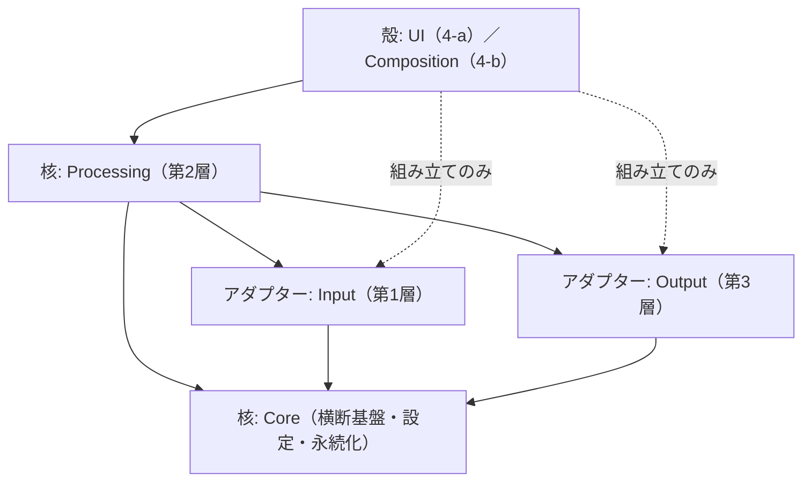
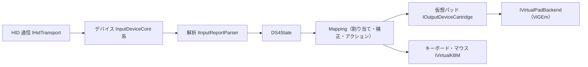

# 構造図（現状）

最終更新: 2026-11-10（Phase17-0 で、旧 4 文書を整理して作り直した）。
この文書は **実在するものだけ**を書く。目標像・構想は `Ideas.md`、機種や出力を足す手順は `02-Extension-Guide.md`、登録と寿命は `03-Lifecycle-and-DI.md`。旧 4 文書は `Archive/`（読むだけ。更新しない）。
「実在する主要な型」の表の 1 列目の型名は、`ModelDiagramGuardTests` が実在を検査する。型を改名・削除したら、この表も直す。

---

## 1. 3 つのまとまり（説明のための呼び方）

規則やフォルダの名前は変えず、読む人のための説明として、層を次の 3 つに分けて呼ぶ。

| 呼び方 | 層（フォルダ） | 役割 |
|---|---|---|
| **核**（かく） | 第2層 `Processing/`、`Core/` | 入力の処理・割り当て・プロファイル・設定。アプリの意味を決める部分。外の世界（機器・出力先・画面）の具体を知らない |
| **アダプター** | 第1層 `Input/`（入力機器）、第3層 `Output/`（出力先）、`Core/Platform`（OS） | 外の世界との接続。核が定めた契約（インターフェース）を実装する |
| **殻**（から） | 第4層 `UI/`（画面）、`Composition/`（組み立て） | 画面と、全部品の組み立て。`Composition/` だけが全層の具象を知ってよい |

## 2. 層と依存の向き

- 依存は **殻 → 核（第2層）→ { 第1層、第3層、Core }**。第1層・第3層・Core から第2層・殻への参照は禁止。第2層が第1層・第3層を使うときは、第2層側の `Processing/Abstractions` のインターフェース経由。
- 規則は `LayerDependencyRuleTests`（ArchUnitNET）が検査する。違反の許可リスト `LayerDependencyBaseline` は空に保つ。

| 規則 | 内容 |
|---|---|
| L1 | Core は 第2層・UI・Composition を参照しない |
| L2 | Core は 第1層・第3層を参照しない |
| L3 | 第1層は 第2層・第3層・UI・Composition を参照しない |
| L4 | 第3層は 第2層（契約を除く）・UI・Composition を参照しない |
| L5 | 第2層は UI・Composition を参照しない |
| L6 | UI は Composition を参照しない |
| L7 | UI は 第1層・第3層を参照しない |
| L9 | 仮想パッドのドライバー（ViGEm）の型は `Output/Backend` の中だけ（`VirtualPadBackendBoundaryTests`） |
| L10 | `HidDevice` の具象は `DS4Windows.Input.Hid` の中だけ |

## 3. フォルダと層の対応

| フォルダ | 層 | 中身 |
|---|---|---|
| `Input/` | 第1層 | `Abstractions`（契約）、`Devices`（機種ごとのデバイスとカートリッジ）、`Parsers`（バイト列の解析）、`Hid`（HID 通信） |
| `Processing/` | 第2層 | `Abstractions`（契約）、`Actions`（アクションの仕組み）、`Services`（処理の実装）、ルート直下（`ControlService`、`Mapping` など） |
| `Output/` | 第3層 | `Abstractions`、`Backend`（ViGEm）、`Devices`（仮想パッドの種類）、`Kbm`（キーボード・マウス出力）、`Services` |
| `UI/` | 4-a | `Abstractions`、`ViewModels`、`Controls`、`Converters`、`Themes`、`Services`（ViewModel／ウィンドウの工場） |
| `Composition/` | 4-b | `AppHost`、`ServiceRegistration`（DI 登録。層ごとの partial）、`Startup` |
| `Core/` | 横断 | `Abstractions`、`Model`（共有の値の型）、`Logging`、`Utilities`、`Platform`、`Settings`、`Persistence`、`Profiles`、`Updater` |

## 4. 入力から出力までの流れ

- 毎フレームの経路（Mapping）は割り当て 0 を保つ。
- 切断時の後始末は `IDeviceInputCleanup`、ライトバーの色は `ILightbarService`。

## 5. 実在する主要な型

| 型 | 層 | 役割 |
|---|---|---|
| `ControlService` | 2 | 接続デバイスと出力スロットの全体の統括 |
| `Mapping` | 2 | 入力の評価（カーブ・割り当て・合成入力） |
| `TriggerDispatchEngine` | 2 | 特殊アクションと割り当ての判定→実行 |
| `SyntheticDispatcherService` | 2 | 合成キー・マウスの送出 |
| `CurveAndDeadzoneStage` | 2 | 入力の補正の段 |
| `MouseConversionStage` | 2 | マウス変換の段 |
| `DeviceInputCleanup` | 2 | 切断時の後始末 |
| `LightbarService` | 2 | ライトバーの色の計算 |
| `ProfileApplicationService` | 2 | プロファイルのスロット適用・復帰 |
| `AutoProfileService` | 2 | 前面アプリによるプロファイルの自動切替 |
| `InputDeviceModuleRegistry` | 2 | 機種ごとの接続フック（`IInputDeviceModule`）の登録簿 |
| `Ds4DeviceModule` | 2 | DS4 の接続フック |
| `InputDeviceCore` | 1 | 入力デバイスの共通の基底（状態・イベント・設定・切断。読み取りのループは持たない抽象クラス） |
| `InputLoopDevice` | 1 | 読み取りのループの骨組み（1 フレームの流れと、機種が書く差し込み口） |
| `DualShock4Device` | 1 | DualShock 4（USB／BT／ワイヤレスアダプター） |
| `DS4Devices` | 1 | 接続デバイスの列挙と生成 |
| `DualSenseDevice` | 1 | DualSense |
| `SwitchProDevice` | 1 | Switch Pro |
| `Ds4DeviceCartridge` | 1 | DS4 の VID/PID の表と生成 |
| `Ds4ReportParser` | 1 | DS4 のレポートの解析 |
| `HidDevice` | 1 | HID 通信の実装 |
| `OutputSlotManager` | 3 | 仮想パッドのスロット管理 |
| `Ds4OutputCartridge` | 3 | DS4 型の仮想パッド |
| `Xbox360OutputCartridge` | 3 | Xbox 360 型の仮想パッド |
| `ViGEmVirtualPadBackend` | 3 | ViGEm によるバックエンド |
| `InputDeviceTypeInfo` | Core | 機種の種類・系統の対応表 |
| `OutContTypeInfo` | Core | 出力の種類の保存キー・選択肢の表 |
| `ControlServiceDeviceOptions` | Core | 機種系統ごとの設定の入れ物 |
| `ProfileSettingsService` | Core | ロード済みプロファイルの設定 |
| `ProfileRepository` | Core | プロファイルの一覧と CRUD |
| `AppHost` | 4-b | DI ホストの構築 |
| `ServiceRegistration` | 4-b | DI 登録（層ごとの partial） |
| `ViewModelFactory` | 4-a | ViewModel の生成の窓口 |
| `MainWindowFactory` | 4-a | メイン画面の生成 |
| `EditorWindowFactory` | 4-a | 編集画面の生成 |

## 6. 検査で守っているもの

| 検査 | 守るもの |
|---|---|
| `LayerDependencyRuleTests` | 依存の向き（L1〜L7） |
| `VirtualPadBackendBoundaryTests` | ViGEm の型の置き場所（L9、L10） |
| `ConstructorArityRuleTests` | コンストラクターの引数 15 以下（超える型は基準に凍結） |
| `Phase14NamespaceFolderGuardTests` | 名前空間＝フォルダ |
| `RemovedApiRuleTests` | 撤去した型・メンバーが戻らないこと |
| `ModelDiagramGuardTests` | この文書の型の表が実在すること |
